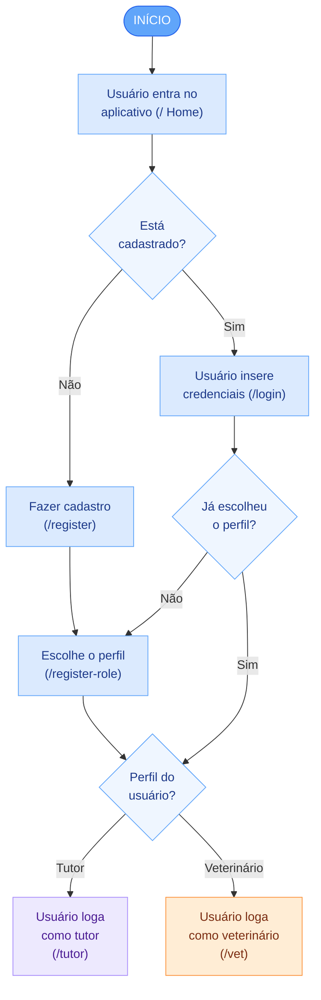
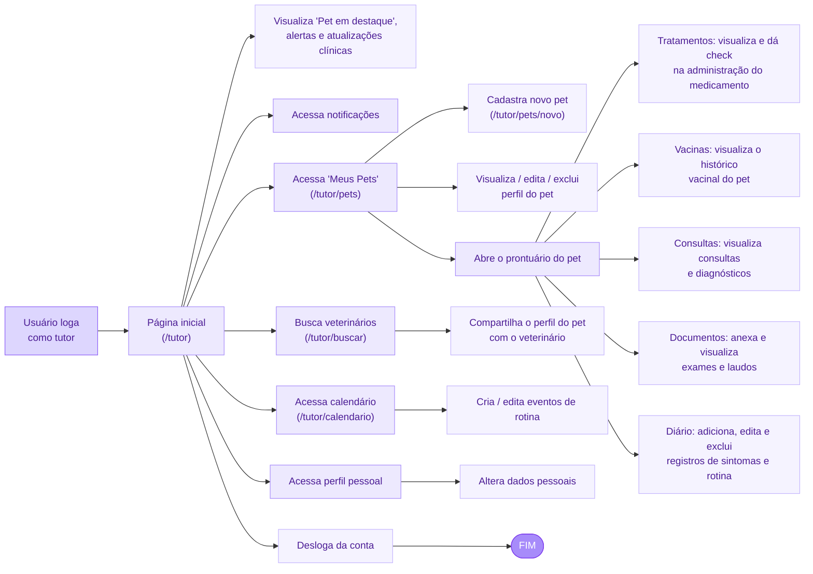
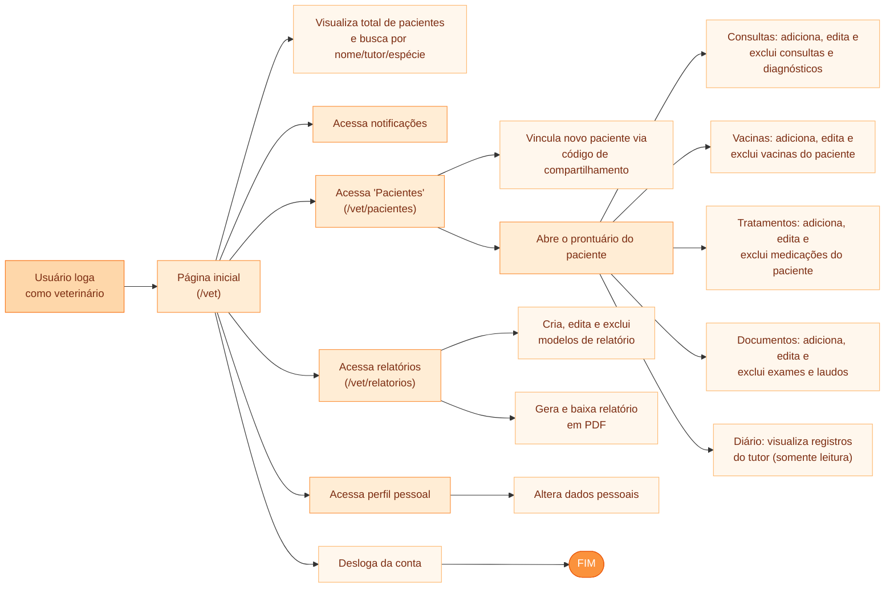

# 🏗️ Etapa 1: Contexto e Planejamento da Solução Distribuída

Este documento serve como diretriz mestre e repositório de evidências para a **Etapa 1: Contexto e Planejamento da Solução**. Ele foi estruturado de forma a facilitar o acompanhamento e auto-gestão das atividades pelos alunos.

---

## 🎯 Rubricas de Avaliação desta Etapa

Ao final desta Etapa, cada aluno será avaliado individualmente nestas 5 competências:

1. **H26a-ADS-CST: Definir o problema de forma clara e objetiva, apresentando os objetivos, a justificativa e a motivação da escolha**: Definir o problema de forma clara e objetiva, apresentando os objetivos, a justificativa e a motivação da escolha (Medido na seção [Catálogo de Serviços Web](#-catalogo-de-servicos-web)).
2. **H26b-ADS-CST - Identificar os perfis de usuários, investigar suas necessidades e elaborar Personas.**: Identificar os perfis de usuários, investigar suas necessidades e elaborar Personas. (Medido na seção [Arquitetura da Solução](#-arquitetura-da-solucao)).
3. **H26c-ADS-CST - Definir os requisitos funcionais e não funcionais do projeto de acordo com o contexto levantado**: Definir os requisitos funcionais e não funcionais do projeto de acordo com o contexto levantado (Medido na seção [Especificação de Contratos de APIs](#-especificacao-de-contratos-de-apis)).
4. **H24a-ADS-CST - Definir e documentar a arquitetura da aplicação distribuída**: Definir e documentar a arquitetura da aplicação distribuída (Medido na seção [Projeto do Frontend Web](#-projeto-do-frontend-web)).

---

## 📅 Cronograma do Semestre (Semana → Período)

Esta tabela é a referência única de planejamento semanal do projeto, usada por todas as Etapas. Ela usa **número relativo de semana** (Semana 1, Semana 2...), não datas fixas, para que o template continue válido em qualquer semestre — cada turma ancora a "Semana 1" na semana real de início da disciplina.

| Semana | Etapa | Atividade Prevista                                                           |
| :----: | :---: | :--------------------------------------------------------------------------- |
|   1    |   1   | Apresentação do Projeto                                                      |
|   2    |   1   | Definição dos Temas e Organização dos Grupos                                 |
|   3    |   1   | Especificações do Projeto                                                    |
|   4    |   1   | Arquitetura da Solução                                                       |
|   5    |   2   | Desenvolvimento de Funcionalidades - API (inclui apresentação da Etapa 1)    |
|   6    |   2   | Desenvolvimento de Funcionalidades - API                                     |
|   7    |   2   | Desenvolvimento de Funcionalidades - API                                     |
|   8    |   2   | Desenvolvimento de Funcionalidades - API                                     |
|   9    |   2   | Testes - API                                                                 |
|   10   |   3   | Desenvolvimento de Funcionalidades - Web (inclui apresentação da Etapa 2)    |
|   11   |   3   | Desenvolvimento de Funcionalidades - Web                                     |
|   12   |   3   | Desenvolvimento de Funcionalidades - Web                                     |
|   13   |   3   | Testes - Front-End Web                                                       |
|   14   |   4   | Desenvolvimento de Funcionalidades - Mobile (inclui apresentação da Etapa 3) |
|   15   |   4   | Desenvolvimento de Funcionalidades - Mobile                                  |
|   16   |   4   | Desenvolvimento de Funcionalidades - Mobile                                  |
|   17   |   4   | Testes - Front-End Mobile                                                    |
|   18   |   5   | Apresentação Final do Projeto                                                |

_As Semanas 1 e 2 não possuem tarefa de documentação associada (organização inicial do grupo e apresentação do projeto)._

---

## 📅 QUADRO DE CONTRIBUIÇÃO REAL (ETAPA 1)

**Atenção alunos:** Preencham esta tabela para atualizar o andamento das tarefas e quem foi o responsável por cada entrega. Garanta que o nome, usuário do GitHub e o link para a seção onde está o seu trabalho estejam devidamente preenchidos.

- **Status admitidos**: `⌛ Não Iniciado` | `📝 Em Progresso` | `✔️ Entregue`
- **Autoria Git**: Indica se há commits desse estudante modificando a seção correspondente.

**Atividades Semanais desta Etapa** (ver [Cronograma do Semestre](#-cronograma-do-semestre-semana--periodo)):

- `ATV1.1` — Especificações do Projeto (Semana 3)
- `ATV1.2` — Arquitetura da Solução (Semana 4)

| Rubrica Curricular | ID Tarefa | Atividade Semanal | Descrição Detalhada da Tarefa                        | Estudante Responsável | GitHub Username | Status de Entrega | Evidência/Seção Temática                                | Autoria Git |
| :----------------: | :-------: | :---------------: | :--------------------------------------------------- | :-------------------- | :-------------: | :---------------: | :------------------------------------------------------ | :---------: |
|      **H26a**      |  `T1.1`   |     `ATV1.1`      | Definição do Problema, Objetivos e Justificativa     | [Nome do Aluno 1]     |   `username1`   | `⌛ Não Iniciado` | [Seção 1](#11-problema-objetivos-e-justificativa)       |     [ ]     |
|      **H34a**      |  `T1.2`   |     `ATV1.1`      | Descrição das Personas e Mapa de Stakeholders        | [Nome do Aluno 2]     |   `username2`   | `⌛ Não Iniciado` | [Seção 1.2](#12-personas-e-stakeholders)                |     [ ]     |
|      **H34a**      |  `T1.3`   |     `ATV1.1`      | Definição de Requisitos Funcionais e Priorização     | [Nome do Aluno 3]     |   `username3`   | `✔️ Entregue`     | [Seção 2.1](#21-requisitos-funcionais-não-funcionais-e-restriçoes) |     [ ]     |
|      **H34a**      |  `T1.3a`  |     `ATV1.1`      | Modelagem de Processos de Negócio (Padrão BPMN)      | [Nome do Aluno 4]     |   `username4`   | `✔️ Entregue`     | [Seção 1.4](#14-modelagem-dos-processos-de-negocio-bpmn) |     [ ]     |
|      **H34a**      |  `T1.3b`  |     `ATV1.1`      | Indicadores de Desempenho e Metas dos Processos      | [Nome do Aluno 5]     |   `username5`   | `✔️ Entregue`     | [Seção 1.5](#15-indicadores-de-desempenho-e-metas-dos-processos-de-negocio) |     [ ]     |
|      **H34a**      |  `T1.4`   |     `ATV1.1`      | Catálogo de Serviços Web e Acordos de SLA            | [Nome do Aluno 1]     |   `username1`   | `⌛ Não Iniciado` | [Seção 3.0](#-catalogo-de-servicos-web)                 |     [ ]     |
|      **H35a**      |  `T1.5`   |     `ATV1.2`      | Diagrama de Componentes Físico e Lógico da Solução   | [Nome do Aluno 4]     |   `username4`   | `⌛ Não Iniciado` | [Seção 4.1](#41-diagrama-de-arquitetura)                |     [ ]     |
|      **H35a**      |  `T1.6`   |     `ATV1.2`      | Definição das Tecnologias Distribuídas e Hospedagem  | [Nome do Aluno 5]     |   `username5`   | `⌛ Não Iniciado` | [Seção 4.2](#42-tecnologias-e-hospedagem)               |     [ ]     |
|      **H36a**      |  `T1.7`   |     `ATV1.2`      | Especificação de Contratos de API (Endpoints/Verbos) | [Nome do Aluno 6]     |   `username6`   | `⌛ Não Iniciado` | [Seção 5.0](#-especificacao-de-contratos-de-apis)       |     [ ]     |
|      **H37a**      |  `T1.8`   |     `ATV1.2`      | Wireframes do Frontend Web e Fluxograma de Navegação | [Nome do Aluno 3]     |   `username3`   | `✔️ Entregue`     | [Seção 6.0](#-projeto-do-frontend-web)                  |     [ ]     |
|      **H38a**      |  `T1.9`   |     `ATV1.2`      | Wireframes do Frontend Móvel e Fluxo de Gestos       | [Nome do Aluno 2]     |   `username2`   | `⌛ Não Iniciado` | [Seção 7.0](#-projeto-do-frontend-movel)                |     [ ]     |

---

# 1. Introdução e Contexto

O cuidado com a saúde de animais de estimação passou a ser uma prioridade para diversas famílias, exigindo um acompanhamento tão rigoroso quanto o dedicado a seres humanos. Contudo, o panorama atual do cuidado animal é caracterizado pela pulverização de informações veterinárias e pela ausência de controle sobre quem manuseia esses dados médicos. A questão central está na desorganização e no extravio de dados relevantes, além do risco associado a tutores que administram posologias e prescrições sem o cuidado necessário, o que acarreta consequências diretas na saúde do animal.

Esse cenário ganhou peso legal com a Resolução nº 1.653/2025 do CFMV, que tornou o prontuário veterinário um documento técnico-legal obrigatório, exigindo evolução diária assinada eletronicamente pelo veterinário, anexação de laudos e prazo máximo de 5 dias úteis para entrega de cópias. Isso, somado à lógica de Saúde Única (One Health), torna a gestão manual ou descentralizada inviável.

Diante desse cenário, este projeto tem como propósito geral construir o "Prontuário Pet Inteligente", uma aplicação distribuída formada por versões Web e mobile que reúne toda a saúde do animal em um só lugar, com permissões de acesso rígidas que distinguem a observação cotidiana da prescrição médica. Essa distribuição entre diferentes perfis de usuário, meios de acesso e módulos funcionais independentes possibilita que o sistema funcione de forma desacoplada e escalável, preservando, ao mesmo tempo, um histórico único e coerente por animal.

A justificativa para este desenvolvimento sustenta-se na necessidade de eliminar falhas na imunização, prevenir erros de tratamento e fornecer dados precisos para diagnósticos. O público-alvo abrange tutores contemporâneos com necessidades variadas e médicos veterinários que prec

## 1.1. Problema, Objetivos e Justificativa

- **O Problema**:

No cenário atual da rotina de cuidados animais, a gestão da saúde do pet sofre com a descontinuidade da informação e a ausência de centralização. O tutor frequentemente perde ou não localiza informações essenciais, como carteiras de vacinação, registros de alergias ou resultados de exames anteriores em momentos críticos, o que compromete e atrasa os atendimentos de urgência.

Analisando de ponta a ponta, essa desorganização não é apenas uma questão burocrática, mas um sério gerador de risco clínico. Sem uma gestão bem definida, ocorrem falhas na imunização por descuido, necessidade de repetir exames invasivos sem necessidade real (com custo financeiro e físico duplicado) e, sobretudo, uma alta probabilidade de erros de tratamento, nos quais o tutor pode equivocar-se em doses ou horários de medicamentos prescritos.

Além disso, no cotidiano da casa do tutor, surge o problema da invisibilidade dos padrões. O dono do animal presencia acontecimentos isolados, como uma mudança na alimentação seguida de um episódio de vômito horas depois, mas não consegue organizar essas observações. Como resultado, o tutor toma decisões sem fundamento e o veterinário não recebe as informações necessárias para converter esses indícios em medicina preventiva e diagnósticos precisos.

- **Objetivo Geral**:
  Desenvolver uma aplicação distribuída, nos formatos Web e mobile, que atue como o dossiê de saúde definitivo do animal, solucionando o problema da fragmentação de registros através da centralização de dados dispersos em informação acionável e acessível em segundos.

- **Objetivos Críticos Específicos (Mínimo de 3)**:

  1.Garantir a segurança em tratamentos e imunizações através de governança de dados: Desenvolver módulos de "Vacinas" e "Medicamentos" onde a criação e edição das prescrições (posologia exata, frequência, cálculo de próxima dose) sejam de acesso exclusivo do perfil Veterinário, restabelecendo ao Tutor apenas a função de visualização e confirmação (check) da administração, mitigando os erros de tratamento.

  2.Implementar um diário de Rotina: Criar um "Diário do Pet" gerido integralmente pelo tutor para o registro de sintomas e rotina diária (vômitos, coceiras), permitindo que o sistema ilumine padrões de causa e efeito que serão visualizados de forma estruturada pelo médico veterinário em consultas.

  3.Estabelecer uma Memória Clínica interoperável: Construir um repositório digital de "Histórico Clínico e Exames" onde tanto tutores quanto veterinários possam adicionar documentos e eventos médicos colaborativamente, garantindo que o histórico acompanhe o animal de forma unificada e ágil.

  4.Estruturar o módulo de Consulta: disponibilizar um módulo dedicado às consultas, no qual o Veterinário mantenha controle completo sobre os registros clínicos gerados, e o Tutor acesse as informações conforme as regras de permissão estabelecidas para o seu perfil.

  5.Estruturar o módulo Financeiro: implementar o controle financeiro do sistema, de acesso exclusivo ao perfil Veterinário, com visibilidade concedida ao Tutor conforme a necessidade de cada situação.

  6.Disponibilizar relatórios: permitir que tutores e veterinários gerem e acompanhem relatórios consolidados a partir dos dados registrados no sistema, apoiando decisões clínicas e o acompanhamento do histórico do animal.

- **Justificativa**:
  A motivação principal para o desenvolvimento desta aplicação é transcender a simples "organização" para entregar segurança real e eliminar a ansiedade da gestão de saúde animal. O desenvolvimento de um sistema com permissões baseadas em papéis justifica-se pelo fato de que a ausência de gestão centralizada gera o risco real de erros de dose. Um problema que não é hipotético: um estudo conduzido no Hospital Veterinário da Universidade Federal Rural da Amazônia, que analisou 406 receituários eletrônicos prescritos por veterinários residentes, constatou que todas as prescrições continham pelo menos um erro, sendo os mais frequentes a ausência da quantidade total de medicamento, siglas e abreviaturas incorretas e falhas na concentração informada. Outra fonte técnica estima que erros de dosagem afetam cerca de 10% dos casos clínicos na rotina veterinária, reforçando que mesmo profissionais experientes estão sujeitos a falhas de cálculo sob pressão de tempo.

Ao aprofundar a aplicação em restrições onde apenas o veterinário insere a dose exata e o tutor apenas consome o alerta ativo, o software elimina a dependência da memória do tutor, garantindo que o tratamento seja seguido à risca.

Além disso, a escolha de focar em um histórico médico colaborativo justifica-se pela premissa de que o "histórico acompanha o animal, não a clínica". Isso assegura aos donos a certeza de que, em uma emergência ou viagem, um novo veterinário de referência receberá imediatamente o perfil compartilhado completo com exames e cirurgias, tendo tudo o que precisa para salvar o animal; eliminando a fragmentação de dados entre diferentes clínicas que hoje compromete a continuidade do cuidado.

---

## 1.2. Personas e Stakeholders

## 1. Médica veterinária de clínica geral


**Nome:** Mariana Costa
**Idade:** 34 anos
**Experiência:** 9 anos
**Contexto:** Trabalha em uma clínica veterinária de médio porte e atende aproximadamente 15 animais por dia.

**Objetivos**

- Consultar rapidamente o histórico dos pacientes.
- Registrar informações durante ou após uma consulta.
- Acompanhar tratamentos e medicamentos prescritos.
- Verificar se vacinas estão atualizadas.
- Organizar sua agenda de consultas.

**Dificuldades**

- Informações dos pacientes ficam espalhadas entre fichas, mensagens e sistemas diferentes.
- Perde tempo procurando resultados ou informações de consultas anteriores.
- Tutores frequentemente não lembram quais medicamentos o animal está utilizando.

**Necessidades no sistema**

- Histórico de saúde centralizado.
- Visualização rápida de medicamentos, vacinas e consultas.
- Registro de diagnóstico e observações.
- Agenda organizada por dia.

**Uso de tecnologia:** Alto.

## 2. Médico veterinário e proprietário de clínica


**Nome:** Roberto Almeida
**Idade:** 41 anos
**Experiência:** 16 anos
**Contexto:** Além de realizar atendimentos, administra uma clínica com outros veterinários.

**Objetivos**

- Tornar o atendimento mais organizado.
- Evitar perda de informações dos pacientes.
- Facilitar a continuidade do atendimento entre diferentes veterinários.
- Reduzir registros em papel.

**Dificuldades**

- Um mesmo animal pode ser atendido por diferentes profissionais.
- Informações podem ficar incompletas ou duplicadas.
- A equipe perde tempo buscando fichas antigas.

**Necessidades no sistema**

- Prontuário centralizado.
- Histórico atualizado.
- Identificação clara das consultas realizadas.
- Agenda de pacientes.

**Uso de tecnologia:** Médio-alto.

## 3. Professora aposentada


**Nome:** Dona Helena Martins
**Idade:** 63 anos
**Pet:** Bob, cão de 11 anos
**Contexto:** Bob é um animal idoso e possui problemas de saúde que exigem acompanhamento frequente e uso contínuo de medicamentos.

**Objetivos**

- Acompanhar o tratamento do Bob.
- Consultar quais medicamentos ele utiliza.
- Registrar mudanças no comportamento ou alimentação.
- Acompanhar consultas frequentes.

**Dificuldades**

- Tem dificuldade para lembrar nomes de medicamentos.
- Pode se confundir com diferentes horários e dosagens.
- Não possui tanta familiaridade com sistemas complexos.

**Necessidades no sistema**

- Interface simples e legível.
- Informações objetivas.
- Histórico de medicamentos.
- Registro fácil de observações.

**Uso de tecnologia:** Médio-baixo.

## 4. Família viajante


**Nomes:** Fernanda e João Castro
**Idades:** 29 e 31 anos
**Contexto:** Casal de nômades digitais, tutores do "Zeus", um Border Collie que os acompanha em todas as trilhas e viagens, estão sempre cruzando fronteiras estaduais e frequentando novos ambientes com o pet.

**Objetivos**

- Ter acesso imediato à carteira de vacinação digital em aeroportos, hotéis e postos de fiscalização.
- Garantir que a "Memória Clínica" do Zeus esteja disponível em qualquer cidade caso ele precise de atendimento urgente.
- Centralizar resultados de exames de sangue e laudos para evitar repetições desnecessárias de procedimentos em novas clínicas.

**Dificuldades**

- Insegurança ao frequentar novos veterinários que não conhecem o histórico de alergias do Zeus.
- Dificuldade em carregar pastas físicas de documentos durante as viagens.
- Risco de atrasar diagnósticos por falta de comunicação entre diferentes clínicas de diferentes regiões.

**Necessidades no sistema**

- Acesso rápido e offline-friendly ao histórico de saúde do pet.
- Compartilhamento do perfil do pet com novos veterinários.
- Repositório centralizado de exames e laudos.

**Uso de tecnologia:** Alto.

## 5. Estudante universitária


**Nome:** Ana Beatriz Santos
**Idade:** 24 anos
**Pet:** Luna, gata de 3 anos
**Contexto:** Mora sozinha com sua gata e utiliza principalmente o celular para organizar compromissos.

**Objetivos**

- Acompanhar vacinas da Luna.
- Marcar consultas pelo celular.
- Registrar informações sobre comportamento e sintomas.
- Consultar rapidamente recomendações do veterinário.

**Dificuldades**

- Esquece datas de vacinação.
- Perde documentos físicos da clínica.
- Nem sempre lembra quando determinado sintoma começou.

**Necessidades no sistema**

- Aplicativo mobile simples.
- Histórico de saúde.
- Anotações.
- Agenda de consultas.
- Informações sobre medicamentos e vacinas.

**Uso de tecnologia:** Muito alto.

## Mapa de Interesses dos Stakeholders

**Stakeholders Diretos (Atores principais):**


## 1.3.Histórias de Usuário

| ID | Eu como... | Quero/preciso... | Para... |
|----|-----------|-------------------|---------|
| **TUT-01** | Tutor | criar, visualizar, editar e excluir minha conta de tutor | administrar meus dados e utilizar as funcionalidades de acompanhamento dos meus pets. |
| **TUT-02** | Tutor | criar, visualizar, editar e excluir o cadastro do meu pet, contendo nome, foto, peso, microchip, idade, espécie e raça | manter um perfil centralizado que conecte todas as informações de saúde e bem-estar do animal. |
| **TUT-03** | Tutor | visualizar o histórico de vacinação e inserir vacinas anteriores ao primeiro uso do sistema | iniciar o acompanhamento com um histórico completo e reduzir o risco de falhas na imunização. |
| **TUT-04** | Tutor | marcar como administrada cada dose de um medicamento prescrito | acompanhar diariamente o tratamento do meu pet sem alterar a prescrição realizada pelo veterinário. |
| **TUT-05** | Tutor | enviar, visualizar, atualizar e excluir documentos clínicos, como exames, imagens e receitas | centralizar os documentos de saúde do meu pet e evitar a perda de informações importantes. |
| **TUT-06** | Tutor | registrar e manter eventos médicos, como consultas, cirurgias e internações, na linha do tempo do pet | manter seu histórico de saúde completo e disponível para atendimentos futuros. |
| **TUT-07** | Tutor | criar, visualizar, editar e excluir registros diários sobre sintomas e comportamentos, como vômitos, coceiras e alterações alimentares | identificar padrões e fornecer informações mais precisas ao veterinário. |
| **TUT-08** | Tutor | criar, visualizar, editar e excluir eventos de rotina, como banho, tosa e outros cuidados recorrentes, incluindo agendamento e recorrência | organizar os cuidados de bem-estar do meu pet e evitar o esquecimento de compromissos. |
| **TUT-09** | Tutor | cadastrar, editar e remover contatos de veterinários ou clínicas e conceder ou revogar o acesso deles ao perfil do meu pet | facilitar o compartilhamento das informações de saúde mantendo o controle sobre a privacidade dos dados. |
| **TUT-10** | Tutor | agendar, visualizar e cancelar consultas veterinárias para meus pets | organizar os atendimentos de saúde sem precisar utilizar outros meios de comunicação com a clínica. |
| **VET-01** | Veterinário | criar, visualizar, editar e excluir minha conta de veterinário | utilizar o sistema para acompanhar os pacientes sob meus cuidados. |
| **VET-02** | Veterinário | visualizar os dados cadastrais do pet, como nome, espécie, raça, idade, peso e microchip | obter rapidamente o contexto necessário durante consultas e emergências sem alterar informações cadastradas pelo tutor. |
| **VET-03** | Veterinário | registrar, editar e remover vacinas aplicadas, informando tipo e data, com cálculo da próxima dose e possibilidade de adicionar comprovantes | manter um histórico vacinal confiável e auxiliar o tutor no acompanhamento dos próximos reforços. |
| **VET-04** | Veterinário | criar, editar e encerrar tratamentos, definindo medicamento, dose, frequência e duração, inclusive para medicamentos recorrentes | garantir que o tratamento prescrito seja registrado de maneira clara e reduzir o risco de erros durante sua execução. |
| **VET-05** | Veterinário | adicionar, consultar, editar e remover exames e documentos clínicos do pet | manter uma base documental completa para apoiar diagnósticos e evitar a repetição desnecessária de exames. |
| **VET-06** | Veterinário | registrar diagnósticos e eventos clínicos, como consultas, cirurgias e internações, na linha do tempo do paciente | consolidar seu histórico clínico e apoiar decisões em retornos e emergências. |
| **VET-07** | Veterinário | visualizar as anotações realizadas pelo tutor no diário do pet | identificar padrões, sintomas ou gatilhos que possam contribuir para diagnósticos e condutas preventivas sem alterar os registros do tutor. |
| **VET-08** | Veterinário | visualizar os eventos e cuidados registrados na rotina do pet | compreender seus hábitos e cuidados recorrentes para fornecer orientações mais adequadas sem modificar a agenda criada pelo tutor. |
| **VET-09** | Veterinário | visualizar os perfis de pets cujo acesso foi compartilhado comigo | consultar rapidamente histórico, exames, vacinas e tratamentos dos pacientes autorizados pelo tutor. |
| **VET-10** | Veterinário | visualizar minhas consultas agendadas e acessar o perfil do respectivo paciente | organizar meus atendimentos e consultar previamente as informações clínicas necessárias para cada consulta. |
---

> **Nota:** As seções **1.4 (Modelagem BPMN)**, **1.5 (Indicadores de Desempenho)** e as demais seções (2 a 8) permanecem inalteradas em relação ao documento original. Esta versão separada preenche apenas a **Seção 6 — Projeto do Frontend Web** (ver abaixo). Ao integrar, copie o bloco da Seção 6 desta versão para o `docs/contexto.md` oficial, preservando o restante do conteúdo original.

---

# 6. Projeto do Frontend Web

_(Esta seção atende diretamente à rubrica **H37a**)_

O canal Web do **Prontuário Pet Inteligente** foi projetado como uma Single Page Application (SPA) responsiva, voltada principalmente à produtividade do **Médico Veterinário** (telas densas de prontuário, consultas e relatórios) e ao acompanhamento cotidiano do **Tutor**. A navegação é desacoplada por perfil: após a autenticação via JWT, a aplicação direciona o usuário ao painel correspondente (`/tutor` ou `/vet`), protegendo as rotas privadas por guardiões de rota (*route guards*). As interações descritas a seguir consomem de forma assíncrona as APIs RESTful definidas na [Seção 5](#-especificacao-de-contratos-de-apis), preservando as regras de permissão por papel (RBAC) estabelecidas no projeto.

### 6.1. Relação de Telas do Sistema Web:

A aplicação web é organizada em torno de um ponto de entrada comum (autenticação) e dois fluxos distintos por perfil. A seguir, as telas-chave:

- **Tela 1: Login e Cadastro (`/login`, `/register`, `/register-role`)**: Ponto de entrada comum. O usuário autentica-se com e-mail e senha (consumindo `POST /api/users/login`) ou cria uma nova conta e, em seguida, escolhe seu perfil (Tutor ou Veterinário). O token JWT emitido define o direcionamento e as permissões subsequentes.

- **Tela 2: Dashboard do Tutor (`/tutor`)**: Painel inicial do tutor, que centraliza as informações prioritárias de saúde dos pets sob sua responsabilidade — card de "Pet em destaque", lista de alertas e lembretes (próximas vacinas e doses) e feed de atualizações clínicas recentes registradas pelo veterinário. Disponibiliza acesso às notificações e ao encerramento de sessão.

- **Tela 3: Meus Pets e Cadastro do Pet (`/tutor/pets`, `/tutor/pets/novo`, `/tutor/pets/:petId/editar`)**: Permite ao tutor o gerenciamento completo (criar, visualizar, editar e excluir) do cadastro de seus pets — nome, foto, espécie, raça, idade, peso e microchip —, bem como a abertura do prontuário e o compartilhamento do perfil do animal com um veterinário.

- **Tela 4: Prontuário do Pet / Paciente (abas: Tratamentos, Vacinas, Consultas, Documentos e Diário)**: Tela compartilhada pelos dois perfis (`/tutor/pets/:petId/...` e `/vet/pacientes/:petId/...`), com comportamento ajustado por papel. O Veterinário realiza o gerenciamento completo de vacinas, tratamentos, consultas e documentos; o Tutor visualiza essas informações, confirma a administração de doses e é o único autorizado a criar registros no Diário.

- **Tela 5: Busca de Veterinários e Compartilhamento (`/tutor/buscar`)**: O tutor pesquisa profissionais por nome, endereço ou CRMV e, ao selecionar um veterinário, concede o acesso ao perfil do pet por meio de código/token de compartilhamento temporário (consumindo as rotas de `shares`).

- **Tela 6: Calendário do Tutor (`/tutor/calendario`)**: Visualização mensal de eventos de rotina e cuidados recorrentes (vacina, vermífugo, antipulgas, consulta, tosa), com criação e edição de eventos.

- **Tela 7: Dashboard do Veterinário (`/vet`)**: Painel operacional do veterinário, com indicador do total de pacientes ativos sob seus cuidados, busca preditiva por nome do pet, tutor, espécie ou raça, e grade de cards com acesso direto ao prontuário de cada paciente.

- **Tela 8: Gestão de Pacientes (`/vet/pacientes`, `/vet/pacientes/novo`)**: Painel administrativo com a listagem de todos os pacientes vinculados ao veterinário (foto, espécie, raça, tutor e data da última consulta) e vinculação de novos pacientes por meio do resgate do código de compartilhamento gerado pelo tutor.

- **Tela 9: Relatórios (`/vet/relatorios`)**: Módulo exclusivo do veterinário para a geração e exportação de relatórios consolidados, com criação, edição e exclusão de modelos (templates) e emissão em PDF a partir dos dados registrados no sistema.

#### Fluxograma de Navegação

O fluxograma a seguir representa a navegabilidade da aplicação web, segmentada em três blocos: **Login e Cadastro** (comum), **Fluxo do Tutor** e **Fluxo do Veterinário**. Os diagramas estão em [Mermaid](https://mermaid.js.org/) e são renderizados automaticamente pelo GitHub.

**Bloco 1 — Login e Cadastro**



**Bloco 2 — Fluxo do Tutor**



**Bloco 3 — Fluxo do Veterinário**



### 6.2. Wireframes Web:

Os wireframes a seguir demonstram os layouts desktop das telas-chave. O layout é totalmente responsivo (RNF-02): em resoluções menores a barra lateral colapsa em menu e os *grids* reduzem para uma coluna. As áreas que dependem de dados remotos consomem de forma assíncrona as APIs RESTful (indicadas em cada tela).

> **Protótipo de alta fidelidade (Figma):** [inserir aqui o link público do protótipo no Figma e/ou as imagens exportadas das telas]. Os esboços de baixa fidelidade abaixo servem como referência estrutural e descrevem o consumo de API de cada tela.

**Wireframe 1 — Login (`/login`)** · consome `POST /api/users/login`

```text
+--------------------------------------------------------------+
|                      🐾  PetLife                             |
|            Prontuário de saúde do seu pet                    |
|          +----------------------------------------+          |
|          |  E-mail  [__________________________]  |          |
|          |  Senha   [__________________________]  |          |
|          |          [        ENTRAR        ]       |          |
|          |  Não tem conta?  Criar conta >          |          |
|          +----------------------------------------+          |
+--------------------------------------------------------------+
```

**Wireframe 2 — Dashboard do Tutor (`/tutor`)** · consome dados de pets, alertas e atualizações

```text
+-------------------+------------------------------------------------------+
|  🐾 PetLife       |  Olá, Helena 👋            [🔔 3]     [ Sair ]       |
|  [▸] Início       +------------------------------------------------------+
|  [ ] Meus Pets    |  +------------------------+  +--------------------+  |
|  [ ] Calendário   |  |  PET EM DESTAQUE       |  |  ALERTAS           |  |
|  [ ] Notificações |  |  +------+ Bob          |  |  🔴 Vacina vence   |  |
|  [ ] Buscar       |  |  | foto | Cão · 11a    |  |  🟡 Dose Dipirona  |  |
|  [ ] Perfil       |  |  +------+ 8,2 kg       |  |  🟢 Exame anexado  |  |
|                   |  |  [ Ver prontuário ]    |  +--------------------+  |
|  [ 👤 Helena ]    |  +------------------------+                          |
|  [   Sair    ]    |  ATUALIZAÇÕES CLÍNICAS RECENTES                      |
+-------------------+------------------------------------------------------+
```

**Wireframe 3 — Meus Pets (`/tutor/pets`)** · consome `GET /api/pets`

```text
+-------------------+------------------------------------------------------+
|  SIDEBAR TUTOR    |  Meus Pets                      [ + Novo Pet ]       |
|                   +------------------------------------------------------+
|                   |  +----------------+  +----------------+              |
|                   |  | +----+  Bob     |  | +----+  Luna    |             |
|                   |  | |foto| Cão·11a  |  | |foto| Gato·3a  |             |
|                   |  | [Ver prontuário]|  | [Ver prontuário]|            |
|                   |  | [Editar][Excluir]| | [Editar][Excluir]|           |
|                   |  | [ Compartilhar ] |  | [ Compartilhar ] |          |
|                   |  +----------------+  +----------------+              |
+-------------------+------------------------------------------------------+
```

**Wireframe 4 — Prontuário do Pet / Paciente (abas)** · consome rotas de vacinas, tratamentos, consultas, documentos e diário

```text
+-------------------+------------------------------------------------------+
|  SIDEBAR          |  < Voltar   Bob  (Cão · 11a · 8,2kg)                 |
|                   +------------------------------------------------------+
|                   | [Tratamentos][Vacinas][Consultas][Documentos][Diário]|
|                   +------------------------------------------------------+
|                   |  TRATAMENTOS                     [ + Novo tratamento]|
|                   |  Dipirona 25mg · 2x/dia · 7 dias                     |
|                   |  Hoje:  08h [✔ dada]   20h [ marcar como dada ]      |
+-------------------+------------------------------------------------------+
```

**Wireframe 5 — Dashboard do Veterinário (`/vet`)** · consome `GET /api/pets/shared` e `GET /api/consultas`

```text
+-------------------+------------------------------------------------------+
|  🐾 PetLife VET   |  Dr(a). Mariana · CRMV 12345     [🔔]   [ Sair ]     |
|  [▸] Início       +------------------------------------------------------+
|  [ ] Pacientes    |  +---------------------------+                       |
|  [ ] Novo Pac.    |  | PACIENTES ATIVOS:   18    |                       |
|  [ ] Relatórios   |  +---------------------------+                       |
|  [ ] Perfil       |  Buscar: [__________________] 🔍                     |
|                   |  +-------------+  +-------------+  +-------------+   |
|                   |  | 🐶 Bob      |  | 🐱 Luna     |  | 🐶 Zeus     |   |
|                   |  | [Prontuário]|  | [Prontuário]|  | [Prontuário]|   |
+-------------------+------------------------------------------------------+
```

**Wireframe 6 — Gestão de Pacientes (`/vet/pacientes`)** · consome `POST /api/shares/redeemsharecode`

```text
+-------------------+------------------------------------------------------+
|  SIDEBAR VET      |  Gestão de Pacientes          [ + Novo Paciente ]    |
|                   +------------------------------------------------------+
|                   |  +------------------------------------------------+  |
|                   |  |Foto| Pet  |Espécie|Raça  |Tutor |Últ.consulta  |  |
|                   |  |[  ]| Bob  | Cão   |SRD   |Helena|01/11/2026    |  |
|                   |  |    |      |       |      |      |[Abrir prontu.]| |
|                   |  +------------------------------------------------+  |
|                   |  MODAL Novo Paciente: [ código 8 díg. ] [Vincular]  |
+-------------------+------------------------------------------------------+
```

**Wireframe 7 — Relatórios (`/vet/relatorios`)** · gera e exporta PDF

```text
+-------------------+------------------------------------------------------+
|  SIDEBAR VET      |  Relatórios                     [ + Novo modelo ]    |
|                   +------------------------------------------------------+
|                   |  Paciente [____v]  Período [__/__ a __/__]           |
|                   |  Tipo [ Vacinas | Tratamentos | Consultas ]          |
|                   |              [ Gerar relatório ]  [ Baixar PDF ]     |
+-------------------+------------------------------------------------------+
```

> **Observação de permissão (RNF-03):** vacinas e tratamentos são **criados e editados exclusivamente pelo Veterinário**; o Tutor apenas visualiza e confirma a administração das doses. O **Diário** é de escrita exclusiva do Tutor, cabendo ao Veterinário apenas a visualização. O módulo de **Relatórios** é de acesso exclusivo do Veterinário.

---

> **As seções 7 (Projeto do Frontend Móvel) e 8 (Referências) permanecem conforme o documento original.**
