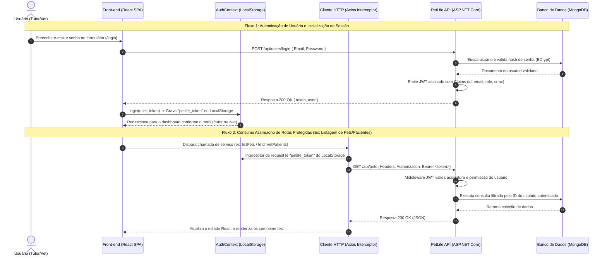
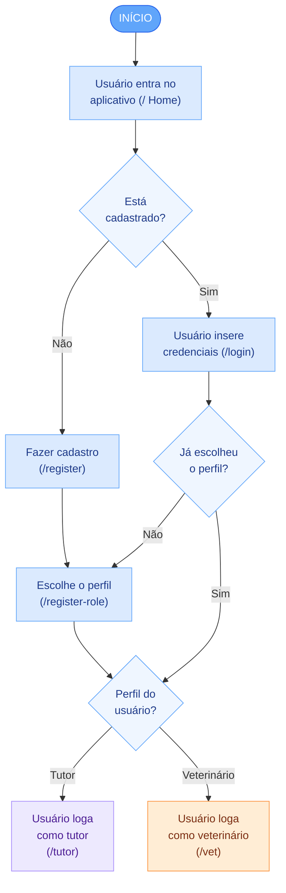
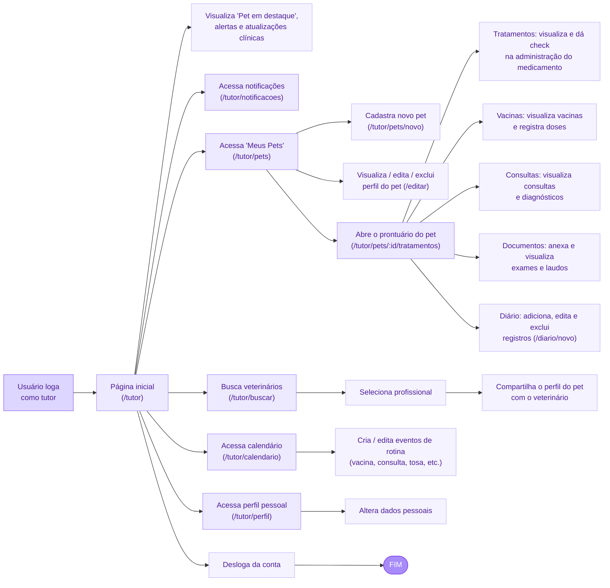
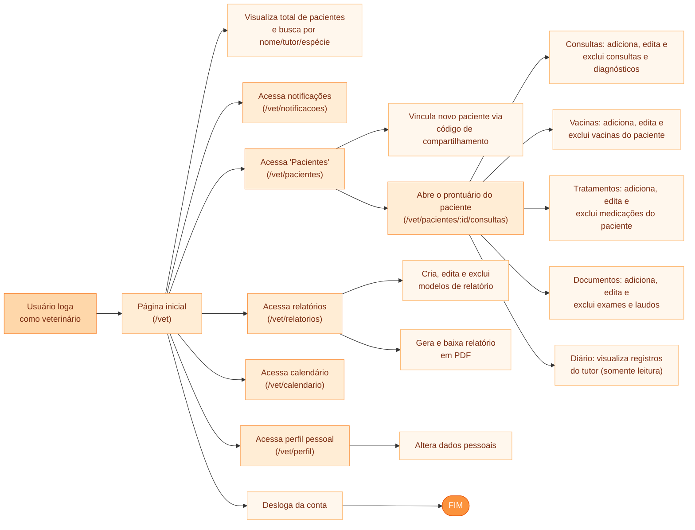
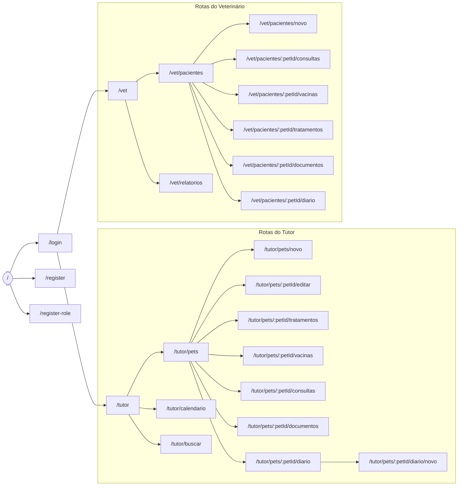

# 💻 Etapa 3: Interface Web Responsiva (Front-end Web)

Este documento serve como diretriz mestre de interface e repositório de evidências para a **Etapa 3: Desenvolvimento do Front-end Web**. Ele foi estruturado para orientar o desenvolvimento prático do cliente web e permitir o acompanhamento e a auto-gestão das atividades pelos alunos.

---

## 🎯 Rubricas de Avaliação desta Etapa

Ao final desta Etapa, cada aluno será avaliado individualmente nestas 6 competências (incluindo oportunidades de desenvolvimento e reavaliação):

1. **H21a-ADS-CST - Aplicar corretamente os padrões de codificação para o desenvolvimento da API.**: Gerenciar e documentar serviços de TI, de forma clara e objetiva (Reavaliação teórica e prática a partir do gerenciamento de serviços no frontend web em [src/frontend/](src/frontend/)).
2. **H21b-ADS-CST - Aplicar corretamente os padrões de codificação para o desenvolvimento da aplicação web.**: Desenvolver uma arquitetura de aplicação distribuída (Integração dinâmica do cliente web com as APIs do backend distribuído desenvolvidas na Etapa 2, medido no código em [src/frontend/](src/frontend/) e na seção [Fluxo de Dados e Integração com Backend](#3-fluxo-de-dados-e-integracao-com-backend)).
3. **H22a-ADS-CST - Utilizar corretamente Framework web MVC.**: Gerenciar uma arquitetura de aplicação distribuída, testando, implantando e avaliando a solução (Processo de empacotamento, otimização de build estático e elaboração da proposta de deploy automatizado do front-end Web, medido na seção [Instruções de Implantação e DevOps Web](#5-instrucoes-de-implantacao-e-devops-web)).
4. **H23c-ADS-CST - Implementar o projeto de interface e o fluxo de telas do sistema de uma aplicação web.**: Planejar e documentar uma aplicação Web, de forma clara e objetiva (Reavaliação/ajustes de planejamento, diagramação e design, medido em [docs/frontend-web.md](docs/frontend-web.md)).
5. **HH24c-ADS-CST - Elaborar e documentar o projeto de interface e o fluxo de telas do sistema de uma aplicação web.**: Desenvolver uma aplicação Web (Construção de telas e componentes funcionais baseados no layout responsivo planejado, consumo de dados assíncronos e controle de estados locais, medido em [src/frontend/](src/frontend/) e na seção [Desenvolvimento de Páginas e Componentes](#2-desenvolvimento-de-paginas-e-componentes)).
6. **H27b-ADS-CST - Desenvolver testes de integração.**: Gerenciar uma aplicação Web, testando, implantando e avaliando a solução (Escrita de suítes de testes automatizados unitários de componentes ou de interface de ponta a ponta, e auditoria de qualidade/performance no ecossistema web, medido na seção [Estratégia e Relatório de Testes Web](#4-estrategia-e-relatorio-de-testes-web)).

---

## 📅 QUADRO DE CONTRIBUIÇÃO REAL (ETAPA 3)

**Atenção alunos:** Preencham esta tabela para atualizar o andamento das tarefas e quem foi o responsável técnico pela construção do Front-end Web. Os nomes, usuários e links de evidências devem corresponder aos entregáveis em [src/frontend/](src/frontend/).

- **Status admitidos**: `⌛ Não Iniciado` | `📝 Em Progresso` | `✔️ Entregue`
- **Autoria Git**: Indica se há commits desse estudante nos arquivos da tarefa.

**Atividades Semanais desta Etapa** (ver [Cronograma do Semestre](contexto.md#-cronograma-do-semestre-semana--periodo)):

- `ATV3.1` — Desenvolvimento de Funcionalidades - Web (Semanas 10 a 12)
- `ATV3.2` — Testes - Front-End Web (Semana 13)

| Rubrica Curricular | ID Tarefa | Atividade Semanal | Descrição Detalhada da Tarefa                                                                                          | Estudante Responsável | GitHub Username | Status de Entrega | Evidência/Seção Temática                                                    | Autoria Git |
| :----------------: | :-------: | :---------------: | :--------------------------------------------------------------------------------------------------------------------- | :-------------------- | :-------------: | :---------------: | :-------------------------------------------------------------------------- | :---------: |
|      **H37b**      |  `T3.1`   |     `ATV3.1`      | Configuração do Projeto Web (Create React App, Vite, etc.)                                                             | [Nome do Aluno 1]     |   `username1`   | `⌛ Não Iniciado` | [Instalação/README](src/frontend/README.md)                                 |     [ ]     |
|      **H37b**      |  `T3.2`   |     `ATV3.1`      | Estilização Global, Layout Base Responsivo e Temas (CSS)                                                               | [Nome do Aluno 2]     |   `username2`   | `⌛ Não Iniciado` | [Seção 1.2](#12-estilizacao-e-design-sistema)                               |     [ ]     |
|      **H37b**      |  `T3.3`   |     `ATV3.1`      | Desenvolvimento das Telas (Home Page de Tutor e veterinário, CRUD completo de Pet, Listagem de Pets de um veterinário) | Lucas Costa           | `Lucasmirandac` |   `✔️ Entregue`   | [Seção 2.1](#21-telas-implementadas)                                        |     [X]     |
|      **H35b**      |  `T3.4`   |     `ATV3.1`      | Consumo Assíncrono da API backend (Services HTTP / Axios)                                                              | [Nome do Aluno 4]     |   `username4`   | `⌛ Não Iniciado` | [Seção 3.2](#32-servicos-de-chamada-a-api)                                  |     [ ]     |
|      **H37b**      |  `T3.5`   |     `ATV3.1`      | Gerenciamento de Estado Global do Cliente (Auth, Rotas Privadas)                                                       | [Nome do Aluno 5]     |   `username5`   | `⌛ Não Iniciado` | [Seção 2.2](#22-rotas-e-estado-de-autenticacao)                             |     [ ]     |
|      **H37c**      |  `T3.6`   |     `ATV3.2`      | Desenvolvimento de Testes Modernos (Jest / Testing Library / Cypress)                                                  | [Nome do Aluno 6]     |   `username6`   | `⌛ Não Iniciado` | [Seção 4.1](#41-arquivos-de-testes)                                         |     [ ]     |
|      **H35c**      |  `T3.7`   |     `ATV3.1`      | Configuração de Build, Otimização (Assets, Caching) e Docker                                                           | [Nome do Aluno 1]     |   `username1`   | `⌛ Não Iniciado` | [Seção 5.1](#51-conteinerisacao-da-aplicacao-web)                           |     [ ]     |
|      **H37c**      |  `T3.8`   |     `ATV3.2`      | Proposta de Implantação e Pipeline de CI/CD Web                                                                        | [Nome do Aluno 5]     |   `username5`   | `⌛ Não Iniciado` | [Seção 5.2](#52-proposta-de-infraestrutura-de-deploy-e-automacao-de-builds) |     [ ]     |

---

# 1. Escopo e Diretrizes da Interface Web

[Insira aqui uma breve introdução descrevendo o escopo técnico do produto Web que foi entregue. Qual framework visual principal foi adotado (ex: React com Vite, Angular, Vue), como a interface se conecta na topologia da sua rede distribuída e como as premissas de UX/UI foram priorizadas.]

## 1.1. Identidade Visual da Interface Web

[Justifique as escolhas visuais do design em conformidade com o que foi planejado na Etapa 1. Descreva brevemente a paleta de cores (ex: Primary `#1B2A47`, Secondary `#E2E8F0`), a tipografia (ex: `Inter, sans-serif`) e a biblioteca de componentes visuais adotada se houver (ex: TailwindCSS, ChakraUI, Bootstrap).]

---

# 2. Desenvolvimento de Páginas e Componentes

_(Esta seção atende diretamente à rubrica **H37b**)_

Abaixo detalhe como as interfaces visuais foram implementadas nos diretórios de código em [src/frontend/](src/frontend/).

## 2.1. Telas Implementadas

Abaixo estão detalhadas as telas chaves desenvolvidas para os dois perfis da aplicação (**Tutor** e **Veterinário**), além da arquitetura de navegação e layout responsivo implementados em `src/frontend/petlife-web/src/`:

- **Tela 1: Dashboard do Tutor (`TutorHomePage` — `/tutor`)**:
  
  - **Objetivo**: Centralizar as informações prioritárias de saúde dos pets sob responsabilidade do tutor autenticado.
  - **Controles e Recursos**:
    - Saudação dinâmica personalizada com o primeiro nome do usuário logado.
    - Botão de Notificações com badge contador de alertas não lidos integrados ao backend.
    - Card do **Pet do Dia / Pet em Destaque** (`FeaturedPetCard`), exibindo foto, espécie, raça, idade, peso e lembrete da próxima vacina e medicação ativa.
    - Grade de **Alertas e Notificações** (`AlertsList`) com códigos visuais de urgência.
    - Feed de **Atualizações Clínicas Recentes** (`VetUpdatesList`) informando laudos e vacinas recém-registradas pelo veterinário.
    - Botão de encerramento de sessão (**Sair/Logout**), acionando limpeza de credenciais no `AuthContext` e redirecionando para a tela de login.

- **Tela 2: Dashboard do Veterinário (`VetHomePage` — `/vet`)**:
  
  - **Objetivo**: Apresentar um panorama operacional consolidado dos pacientes clínicos sob responsabilidade do médico veterinário.
  - **Controles e Recursos**:
    - Saudação profissional com identificação do médico e exibição do CRMV.
    - Card métrico destacando o total de pacientes ativos sob cuidado clínico.
    - Barra de busca preditiva em tempo real permitindo filtrar pacientes instantaneamente por nome do pet, tutor, espécie ou raça.
    - Grid responsivo de cards de pacientes (`VetPatientCard`), contendo link de navegação direta para o prontuário eletrônico completo.
    - Acesso a notificações e botão de logout no cabeçalho superior.

- **Tela 3: Gestão de Pacientes Veterinários (`VetPatientsPage` — `/vet/pacientes`)**:
  
  - **Objetivo**: Painel administrativo detalhado para controle de todos os pacientes vinculados ao veterinário e vinculação de novos animais.
  - **Controles e Recursos**:
    - Tabela estruturada com avatar/foto do pet, espécie, raça, tutor responsável e registro da data da última consulta.
    - Filtro de busca textual abrangente (nome, tutor, espécie).
    - Botão de ação rápida **Abrir Prontuário** direcionando para as abas clínicas (`/vet/pacientes/:petId/consultas`).
    - Modal de **Novo Paciente**: formulário interativo para resgate do código alfanumérico de compartilhamento (8 caracteres) gerado pelo tutor, consumindo a rota assíncrona de vinculação com feedback de sucesso/erro e atualização imediata da listagem.

- **Estrutura de Layout Base e Navegação (`Sidebar`, `VetSidebar`, `TutorLayout`, `VetLayout`)**:
  
  - **Objetivo**: Garantir navegação consistente, intuitiva e acessível em 100% das páginas da aplicação web.
  - **Controles e Recursos**:
    - Barra lateral persistente (`aside`) com estilização diferenciada por perfil (gradiente alaranjado/rosa para Tutores e ciano/azul para Veterinários).
    - Menu de navegação com indicação visual de rota ativa.
    - Rodapé integrado com avatar do usuário, nome, perfil/CRMV e **botão de Logout universal** com confirmação de limpeza de sessão.

## 2.2. Rotas e Estado de Autenticação

[Descreva como o aplicativo lida com autenticação. Explique se há um contexto de autenticação global para guardar o JWT gerado no backend, como o guardião de rotas (Route Guards) protege as páginas privadas de usuários sem login e como os dados são retidos no navegador (ex: localStorage, sessionStorage).]

---

# 3. Fluxo de Dados e Integração com Backend

_(Esta seção atende diretamente à rubrica **H35b**)_

## 3.1. Arquitetura de Comunicação Cliente-Servidor



## 3.2. Serviços de Chamada à API

A camada de integração de rede da aplicação web é estruturada de forma modular, centralizada e fortemente tipada em TypeScript. A comunicação com o backend ASP.NET Core apoia-se em dois pilares:

### 1. Cliente HTTP Centralizado e Interceptor de Autenticação (`src/api/client.ts`)

Todas as requisições HTTP utilizam uma instância singleton do **Axios**. O cliente define a `baseURL` dinamicamente a partir da variável de ambiente `VITE_API_URL` (com fallback seguro para ambiente de desenvolvimento local em `http://localhost:5210`) e implementa um interceptor de requisição que anexa automaticamente o token JWT armazenado no `localStorage` sob o header `Authorization: Bearer <token>`:

```typescript
import axios from "axios";

// URL base da API do backend com suporte a variáveis de ambiente
export const baseURL = import.meta.env.VITE_API_URL ?? "http://localhost:5210";

export const api = axios.create({
  baseURL,
  headers: {
    "Content-Type": "application/json",
  },
});

// Interceptor de requisição: anexa automaticamente o token JWT em toda chamada protegida
api.interceptors.request.use((config) => {
  const token = localStorage.getItem("petlife_token");
  if (token) {
    config.headers.Authorization = `Bearer ${token}`;
  }
  return config;
});

export default api;
```

### 2. Camada de Serviços por Domínio (`src/services/`)

Para desacoplar as telas e componentes visuais das regras de transporte e contratos da API, o projeto organiza as chamadas em módulos de serviços dedicados (`petService.ts`, `vetPatientsService.ts`, `tutorHomeService.ts`, `vetHomeService.ts`, `consultaService.ts`, etc.). 

Exemplo prático de serviço assíncrono consumindo o cliente centralizado (`src/services/vetPatientsService.ts`):

```typescript
import api from "../api/client";
import type { Consulta, SharedPet } from "../types";

export interface VetPatientItem {
  id: string;
  name: string;
  species: string;
  breed: string;
  tutor: string;
  ultimaConsulta: string;
  photo?: string;
}

/**
 * Busca os pacientes compartilhados com o veterinário autenticado e consolida a data da última consulta.
 */
export async function fetchVetPatients(): Promise<VetPatientItem[]> {
  const [petsRes, consultasRes] = await Promise.all([
    api.get<SharedPet[]>("/api/pets/shared"),
    api.get<Consulta[]>("/api/consultas").catch(() => ({ data: [] as Consulta[] })),
  ]);

  const sharedPets = petsRes.data ?? [];
  const consultas = consultasRes.data ?? [];

  return sharedPets.map((pet) => ({
    id: pet.id,
    name: pet.nome,
    species: pet.especie,
    breed: pet.raca?.trim() || "Não informada",
    tutor: pet.tutor_nome?.trim() || "Tutor não informado",
    ultimaConsulta: findLatestConsultaDate(consultas, pet.id),
    photo: pet.foto_url || undefined,
  }));
}

/**
 * Vincula um novo paciente ao veterinário via código de compartilhamento de 8 caracteres.
 */
export async function redeemPatientShareCode(code: string): Promise<void> {
  const cleanCode = code.trim();
  await api.post("/api/shares/redeemsharecode", JSON.stringify(cleanCode), {
    headers: { "Content-Type": "application/json" },
  });
}
```

### 3. Tratamento Padronizado de Erros da API (`src/utils/apiError.ts`)

As respostas de erro HTTP (ex: 400 Bad Request, 401 Unauthorized, 404 Not Found ou erros de rede) são interceptadas e normalizadas pela função utilitária `getApiErrorMessage(err, fallbackMessage)`, extraindo mensagens retornadas pelo backend (`response.data.message` ou `response.data.error`) para exibição amigável e acessível nas telas ao usuário.

---

# 4. Estratégia e Relatório de Testes Web

_(Esta seção atende diretamente à rubrica **H37c**)_

[Descreva como a qualidade da interface e a resiliência a bugs foram validadas no projeto Web. Indique que ferramentas foram aplicadas para rodar os testes localmente.]

## 4.1. Arquivos de Testes

- **Ferramenta de Asserção de Interface**: `Vitest` + `@testing-library/react` + `@testing-library/user-event`.
- **Comando de Execução**: `npm test -- --run`

### Tabela de Cobertura de Testes Web (Telas Chaves e Componentes de Layout):

| Componente Web / Página        | Tipo de Teste         | Cenário de Teste Validado                                                                                                                                      |   Status da Suíte    |
| :----------------------------- | :-------------------- | :------------------------------------------------------------------------------------------------------------------------------------------------------------- | :------------------: |
| **`TutorHomePage`**            | Unitário / Integração | Renderização de sidebar, saudação personalizada, badge de notificações, card de destaque do pet e feeds de alertas e atualizações                              | ✔️ Passou (6 testes) |
| **`VetHomePage`**              | Unitário / Integração | Exibição de cabeçalho com CRMV, estatística total de pacientes sob cuidados, barra de busca com filtragem dinâmica e listagem de pacientes                     | ✔️ Passou (7 testes) |
| **`VetPatientsPage`**          | Unitário / Integração | Tabela de pacientes com busca por nome/espécie/tutor, link para prontuário, abertura e validação de modal com código de compartilhamento e tratamento de erros | ✔️ Passou (7 testes) |
| **`Sidebar` (Tutor)**          | Unitário              | Navegação completa por links ativos, renderização do avatar/nome do tutor e disparo da rotina de encerramento de sessão (Logout)                               | ✔️ Passou (2 testes) |
| **`VetSidebar` (Veterinário)** | Unitário              | Links de navegação clínica, dados profissionais (CRMV) e disparo da função de Logout e redirecionamento para login                                             | ✔️ Passou (2 testes) |

---

# 5. Instruções de Implantação e DevOps Web

_(Esta seção atende diretamente à rubrica **H35c**)_

## 5.1. Conteinerização da Aplicação Web

[Descreva se o projeto conta com dockerização para servir a interface Web. Por exemplo, uso de imagens multi-stage contendo a etapa de geração de build node e a etapa final rodando um proxy reverso estático como o Nginx para melhor performance.]

- **Caminho do Dockerfile do Frontend Web**: `[src/frontend/Dockerfile](src/frontend/Dockerfile)`

---

## 5.2. Proposta de Infraestrutura de Deploy e Automação de Builds

Abaixo, apresente a proposta teórica de como o build de produção seria gerido e publicado. **Nota:** Não há cobrança de deploy prático na nuvem para esta disciplina; a avaliação consiste na demonstração teórica do plano de implantação/hospedagem e nos testes de interface executados localmente.

- **Serviço de Hospedagem Planejado**: (Ex: `Vercel`, `Netlify`, `GitHub Pages`).
- **Proposta de Fluxo Contínuo**: Explique como o build estático de produção seria planejado de forma automatizada no repositório (ex: GitHub Actions disparando build/teste a cada push).
- **Tratamento de Variáveis e Integração**: Descreva de forma textual como o frontend web se comunicaria com as URLs de variáveis de ambiente secretas em produção para apontar para as APIs distribuídas sem hardcode.

---

# 6. Projeto do Frontend Web — Fluxograma de Navegação e Wireframes

_(Esta seção atende diretamente à rubrica **H37a** / tarefa `T1.8`.)_

> **Projeto:** PetLife — Prontuário Eletrônico Distribuído para Pets
> **Perfis do sistema:** **Tutor** e **Veterinário**

Esta seção apresenta o **Diagrama de Fluxo (Fluxograma de Navegação)** e os **Wireframes** das telas do frontend web do PetLife. Os diagramas estão em [Mermaid](https://mermaid.js.org/) (renderizados automaticamente pelo GitHub) e **refletem fielmente as rotas e telas implementadas** em `src/frontend/petlife-web/src/` — em especial o arquivo de rotas `src/routes/AppRouter.tsx` e os menus de navegação `Sidebar.tsx` (Tutor) e `VetSidebar.tsx` (Veterinário).

---

## 6.1. Diagrama de Fluxo (Fluxograma de Navegação)

O fluxograma segue o **padrão visual** de três blocos coloridos (login / tutor / veterinário), porém todo o **conteúdo — telas, ações e navegação — foi extraído diretamente do código-fonte** do frontend web (`src/frontend/petlife-web/src/`), e não de um desenho de referência:

1. **Login e Cadastro** (azul) — ponto de entrada comum a todos os usuários.
2. **Fluxo do Tutor** (roxo) — jornada do dono do pet.
3. **Fluxo do Veterinário** (laranja) — jornada do profissional.

### 6.1.1. Bloco 1 — Login e Cadastro

Fluxo de entrada no aplicativo até a bifurcação por perfil, conforme `HomePage.tsx`, `LoginPage.tsx`, `RegisterPage.tsx` e `RegisterRole.tsx`. Observação fiel ao código: após o login/cadastro, se o usuário ainda não escolheu o perfil (`hasPickedRole !== "true"`), ele é levado à tela de **escolha de perfil** (`/register-role`); o redirecionamento final (`/tutor` ou `/vet`) é decidido pela `role` (`"Tutor"` / `"Veterinário"`).



### 6.1.2. Bloco 2 — Fluxo do Tutor

Jornada do tutor a partir do login, cobrindo **todas as telas e ações implementadas** no código (menu `Sidebar.tsx` + rotas em `AppRouter.tsx`). A coluna central são as **páginas**; as caixas à direita são as **ações** de cada página. Cobre as histórias **TUT-01 a TUT-10**.



> **Fidelidade ao código:**
> - "Busca veterinários" (`SearchPage`) procura **profissionais** por nome/endereço/CRMV; ao selecionar um vet, o tutor **compartilha** o pet com ele (`SharePetButton` → `POST /api/shares/createshare`).
> - O **Diário** é a única aba em que a criação de registros é **exclusiva do tutor** (botão escondido para o vet).
> - "Dá check na administração do medicamento" corresponde à marcação de dose na página de **Tratamentos**.
> - Os itens **Notificações** e **Perfil** existem no menu, mas ainda **não têm rota dedicada** (ver nota em 6.1.4).

### 6.1.3. Bloco 3 — Fluxo do Veterinário

Jornada do veterinário a partir do login, cobrindo **todas as telas e ações implementadas** (menu `VetSidebar.tsx` + rotas em `AppRouter.tsx`). A coluna central são as **páginas**; as caixas à direita são as **ações**. Cobre as histórias **VET-01 a VET-10**.



> **Fidelidade ao código:**
> - O vínculo de paciente usa o **código de compartilhamento** gerado pelo tutor (`redeemPatientShareCode` → `POST /api/shares/redeemsharecode`).
> - Consultas, Vacinas, Tratamentos e Documentos são **editáveis** pelo vet; o **Diário** é **somente leitura**.
> - **Relatórios** (`ReportsPage`) permite CRUD de modelos e geração/download de PDF.
> - Os itens **Calendário**, **Notificações** e **Perfil** existem no menu, mas ainda **não têm rota dedicada** (ver nota em 6.1.4).

### 6.1.4. Mapa Global de Rotas (fiel ao `AppRouter.tsx`)



> ⚠️ **Nota de fidelidade:** os menus laterais (`Sidebar.tsx` / `VetSidebar.tsx`) incluem os itens **Notificações** (`/tutor/notificacoes`, `/vet/notificacoes`), **Perfil** (`/tutor/perfil`, `/vet/perfil`) e **Calendário do Vet** (`/vet/calendario`). Esses caminhos **ainda não possuem `<Route>` dedicada** no `AppRouter.tsx` e caem nas rotas coringa `/tutor/*` e `/vet/*` (que renderizam a página inicial). Eles aparecem no fluxograma porque estão no menu, mas estão sinalizados aqui como pendentes de implementação de rota.

---

## 6.2. Wireframes do Frontend Web

Wireframes (lo-fi) das telas-chave em resolução **desktop**, baseados nas páginas reais em `src/pages/`. O layout é responsivo (RNF-02): em telas menores a *sidebar* colapsa e os *grids* reduzem para uma coluna.

### 6.2.1. Tela de Login (`/login` — `LoginPage.tsx`)

```text
+--------------------------------------------------------------+
|                      🐾  PetLife                             |
|            Prontuário de saúde do seu pet                    |
|          +----------------------------------------+          |
|          |  E-mail                                 |         |
|          |  [____________________________________] |         |
|          |  Senha                                  |         |
|          |  [____________________________________] |         |
|          |        [      ENTRAR      ]             |         |
|          |  --------  ou  ----------               |         |
|          |  Não tem conta?  Cadastre-se >          |         |
|          +----------------------------------------+          |
+--------------------------------------------------------------+
```
**Elementos:** campos e-mail/senha, botão Entrar (`POST /api/users/login`), link para `/register`. Após o cadastro, `/register-role` define o perfil. Relaciona-se a **TUT-01 / VET-01**.

### 6.2.2. Dashboard do Tutor (`/tutor` — `TutorHomePage.tsx`)

```text
+-------------------+------------------------------------------------------+
|  🐾 PetLife       |  Olá, Helena 👋            [🔔 3]     [ Sair ]       |
|                   +------------------------------------------------------+
|  [▸] Início       |  +------------------------+  +--------------------+  |
|  [ ] Meus Pets    |  |  PET EM DESTAQUE       |  |  ALERTAS           |  |
|  [ ] Calendário   |  |  +------+ Bob          |  |  🔴 Vacina vence   |  |
|  [ ] Notificações |  |  | foto | Cão · 11a    |  |  🟡 Dose Dipirona  |  |
|  [ ] Buscar       |  |  +------+ 8,2 kg       |  |  🟢 Exame anexado  |  |
|  [ ] Perfil       |  |  [ Ver prontuário ]    |  +--------------------+  |
|  +-------------+  |  +------------------------+                          |
|  | 👤 Helena   |  |  ATUALIZAÇÕES CLÍNICAS RECENTES                      |
|  | Tutor       |  |  • Vacina V10 registrada  — 01/11                   |
|  | [ Sair ]    |  |  • Laudo hemograma anexado — 28/10                  |
|  +-------------+  |                                                      |
+-------------------+------------------------------------------------------+
```
**Elementos:** saudação dinâmica, badge de notificações (link `/tutor/notificacoes`), `FeaturedPetCard` (foto, espécie, idade, peso; botão leva a `/tutor/pets/:id/editar`), listas de alertas e atualizações. Menu lateral: Início, Meus Pets, Calendário, Notificações, Buscar, Perfil. Relaciona-se a **TUT-02/03/04**.

### 6.2.3. Meus Pets (`/tutor/pets` — `MyPetsPage.tsx` + `PetCard.tsx`)

```text
+-------------------+------------------------------------------------------+
|  SIDEBAR TUTOR    |  Meus Pets                      [ + Novo Pet ]       |
|                   +------------------------------------------------------+
|                   |  +----------------+  +----------------+              |
|                   |  | +----+  Bob     |  | +----+  Luna    |             |
|                   |  | |foto| Cão·11a  |  | |foto| Gato·3a  |             |
|                   |  | +----+ 8,2 kg   |  | +----+ 4,0 kg   |             |
|                   |  | [Ver prontuário]|  | [Ver prontuário]|            |
|                   |  | [Editar][Excluir]| | [Editar][Excluir]|           |
|                   |  | [ Compartilhar ] |  | [ Compartilhar ] |          |
|                   |  +----------------+  +----------------+              |
+-------------------+------------------------------------------------------+
```
**Elementos:** grid de `PetCard` com ações reais — **Ver prontuário** (`/tutor/pets/:id/tratamentos`), **Editar** (`/tutor/pets/:id/editar`), **Excluir** (confirm) e **Compartilhar** (`SharePetButton` → `POST /api/shares/createshare`, gera código). Botão **+ Novo Pet** → `/tutor/pets/novo`. Relaciona-se a **TUT-02 / TUT-09** / **RF-02, RF-09**.

### 6.2.4. Cadastro/Edição de Pet (`/tutor/pets/novo` e `/:petId/editar` — `PetFormPage.tsx`)

```text
+-------------------+------------------------------------------------------+
|  SIDEBAR TUTOR    |  < Voltar     Cadastrar / Editar Pet                 |
|                   +------------------------------------------------------+
|                   |  Foto     [ 📷 upload ]                              |
|                   |  Nome     [________________]                         |
|                   |  Espécie  [____v]   Raça  [________]                 |
|                   |  Idade    [___]     Peso  [____] kg                  |
|                   |  Microchip[__________________________]              |
|                   |                       [ Cancelar ]  [ Salvar ]      |
+-------------------+------------------------------------------------------+
```
**Elementos:** formulário com nome, foto, espécie, raça, idade, peso e microchip. Relaciona-se a **TUT-02** / **RF-02**.

### 6.2.5. Prontuário do Pet — Abas (`/tutor/pets/:petId/tratamentos` e demais)

```text
+-------------------+------------------------------------------------------+
|  SIDEBAR TUTOR    |  < Voltar   Bob  (Cão · 11a · 8,2kg)                 |
|                   +------------------------------------------------------+
|                   | [Tratamentos][Vacinas][Consultas][Documentos][Diário]|
|                   +------------------------------------------------------+
|                   |  TRATAMENTOS                     [ + Novo tratamento]|
|                   |  Dipirona 25mg · 2x/dia · 7 dias                     |
|                   |  Hoje:  08h [✔ dada]   20h [ marcar como dada ]      |
|                   +------------------------------------------------------+
```
**Elementos:** navegação por abas (Tratamentos, Vacinas, Consultas, Documentos, Diário); para o tutor, foco em **visualizar e dar check** na administração do medicamento. Relaciona-se a **TUT-03 a TUT-06** / **RF-03 a RF-06**.

### 6.2.6. Diário do Pet (`/tutor/pets/:petId/diario` — `DiaryPage.tsx`)

```text
+-------------------+------------------------------------------------------+
|  SIDEBAR TUTOR    |  Diário de Bob               [ + Novo registro ]     |
|                   +------------------------------------------------------+
|                   |  03/11  Vômito após troca de ração        [edit][x] |
|                   |  02/11  Coçando a orelha esquerda          [edit][x]|
|                   |  30/10  Mais disposto após caminhada       [edit][x]|
+-------------------+------------------------------------------------------+
```
**Elementos:** lista cronológica; botão **+ Novo registro** leva a `/tutor/pets/:petId/diario/novo` (`DiaryFormPage.tsx`) — **visível apenas para o tutor**. Relaciona-se a **TUT-07** / **RF-08**.

### 6.2.7. Dashboard do Veterinário (`/vet` — `VetHomePage.tsx`)

```text
+-------------------+------------------------------------------------------+
|  🐾 PetLife VET   |  Dr(a). Mariana · CRMV 12345     [🔔]   [ Sair ]     |
|                   +------------------------------------------------------+
|  [▸] Início       |  +---------------------------+                       |
|  [ ] Pacientes    |  | PACIENTES ATIVOS:   18    |                       |
|  [ ] Novo Pac.    |  +---------------------------+                       |
|  [ ] Calendário   |  Buscar: [__________________] 🔍                     |
|  [ ] Notificações |  (nome, tutor, espécie ou raça)                      |
|  [ ] Perfil       |  +-------------+  +-------------+  +-------------+   |
|  [ ] Relatórios   |  | 🐶 Bob      |  | 🐱 Luna     |  | 🐶 Zeus     |   |
|                   |  | Tutor:Helena|  | Tutor: Ana  |  | Tutor: João |   |
|                   |  | [Prontuário]|  | [Prontuário]|  | [Prontuário]|   |
+-------------------+------------------------------------------------------+
```
**Elementos:** cabeçalho com CRMV, card de pacientes ativos, busca preditiva, grid de cards. Menu lateral: Início, Pacientes, Novo Paciente, Calendário, Notificações, Perfil, Relatórios. Relaciona-se a **VET-09/10**.

### 6.2.8. Gestão de Pacientes (`/vet/pacientes` — `VetPatientsPage.tsx`)

```text
+-------------------+------------------------------------------------------+
|  SIDEBAR VET      |  Gestão de Pacientes          [ + Novo Paciente ]    |
|                   +------------------------------------------------------+
|                   |  Buscar: [______________] 🔍                        |
|                   |  +------------------------------------------------+  |
|                   |  |Foto| Pet  |Espécie|Raça  |Tutor |Últ.consulta  |  |
|                   |  |[  ]| Bob  | Cão   |SRD   |Helena|01/11/2026    |  |
|                   |  |    |      |       |      |      |[Abrir prontu.]| |
|                   |  +------------------------------------------------+  |
+-------------------+------------------------------------------------------+

   MODAL "Novo Paciente" (/vet/pacientes/novo)
   +---------------------------------------------+
   |  Vincular paciente                    [ x ] |
   |  Código de compartilhamento (8 dígitos):    |
   |  [ A 7 X 9 - K 2 P Q ]                       |
   |             [ Cancelar ]  [ Vincular ]      |
   +---------------------------------------------+
```
**Elementos:** tabela (foto, espécie, raça, tutor, última consulta), busca, **Abrir prontuário** (`/vet/pacientes/:id/consultas`), modal de vínculo via código (`redeemPatientShareCode` → `POST /api/shares/redeemsharecode`). Relaciona-se a **VET-09** / **RF-09**.

### 6.2.9. Prontuário do Paciente — Veterinário (`/vet/pacientes/:petId/consultas` e abas)

```text
+-------------------+------------------------------------------------------+
|  SIDEBAR VET      |  Prontuário · Bob (Cão · 11a) · Tutor: Helena        |
|                   +------------------------------------------------------+
|                   | [Consultas][Vacinas][Tratamentos][Documentos][Diário]|
|                   +------------------------------------------------------+
|                   |  CONSULTAS                        [ + Nova consulta ]|
|                   |  01/11  Consulta de rotina — sem alterações  [ed][x]|
|                   |  15/06  Otite tratada com antibiótico        [ed][x]|
+-------------------+------------------------------------------------------+
```
**Elementos:** abas clínicas; consultas, vacinas, tratamentos e documentos **editáveis** (`isVet = true`, botões "+ Nova/Novo" e editar/excluir por item); aba **Diário em somente leitura** (sem "+ Novo registro"). Relaciona-se a **VET-02 a VET-08**.

### 6.2.10. Relatórios do Veterinário (`/vet/relatorios` — `ReportsPage.tsx`)

```text
+-------------------+------------------------------------------------------+
|  SIDEBAR VET      |  Relatórios                                         |
|                   +------------------------------------------------------+
|                   |  Paciente [____v]  Período [__/__ a __/__]           |
|                   |  Tipo [ Vacinas | Tratamentos | Consultas ]          |
|                   |              [ Gerar relatório ]  [ Baixar PDF ]     |
+-------------------+------------------------------------------------------+
```
**Elementos:** geração e download de relatórios consolidados (`reportService.ts` → `downloadReportPdf`). Relaciona-se a **RF-11**.

### 6.2.11. Layout Base e Sidebar (`Sidebar.tsx` / `VetSidebar.tsx`)

```text
+----------------------+   TUTOR: identidade visual laranja/rosa
|  🐾 PetLife          |   VET:   identidade visual ciano/azul
|----------------------|
|  [▸] Início          |   ← item ativo destacado
|  [ ] (demais itens)  |
|----------------------|
|  +----------------+  |
|  | 👤  Nome        |  |   ← rodapé: avatar, nome, perfil/CRMV
|  |    Perfil/CRMV  |  |      (link para /tutor/perfil ou /vet/perfil)
|  |  [   Sair   ]   |  |   ← logout: limpa sessão e vai para /login
|  +----------------+  |
+----------------------+
```
**Elementos:** `aside` persistente com itens de menu reais, indicação de rota ativa, rodapé com dados do usuário e botão **Sair** (`logout()` + `navigate("/login")`).

---

## 6.3. Rastreabilidade (Telas × Rotas reais × Requisitos × Histórias)

| Tela / Fluxo                     | Rota real (`AppRouter.tsx`)             | RF                | História(s)        |
| :------------------------------- | :-------------------------------------- | :---------------- | :----------------- |
| Home pública                     | `/`                                     | —                 | —                  |
| Login                            | `/login`                                | RF-01             | TUT-01, VET-01     |
| Cadastro / Escolha de perfil     | `/register`, `/register-role`           | RF-01             | TUT-01, VET-01     |
| Dashboard do Tutor               | `/tutor`                                | RF-02 a RF-04     | TUT-02/03/04       |
| Meus Pets                        | `/tutor/pets`                           | RF-02             | TUT-02             |
| Cadastro/Edição de Pet           | `/tutor/pets/novo`, `/:petId/editar`    | RF-02             | TUT-02             |
| Prontuário Tutor — Tratamentos   | `/tutor/pets/:petId/tratamentos`        | RF-04             | TUT-04             |
| Prontuário Tutor — Vacinas       | `/tutor/pets/:petId/vacinas`            | RF-03             | TUT-03             |
| Prontuário Tutor — Consultas     | `/tutor/pets/:petId/consultas`          | RF-06             | TUT-06             |
| Prontuário Tutor — Documentos    | `/tutor/pets/:petId/documentos`         | RF-05             | TUT-05             |
| Diário do Pet                    | `/tutor/pets/:petId/diario` (+ `/novo`) | RF-08             | TUT-07             |
| Calendário do Tutor              | `/tutor/calendario`                     | RF-07             | TUT-08, TUT-10     |
| Buscar                           | `/tutor/buscar`                         | RF-02             | TUT-02             |
| Dashboard do Veterinário         | `/vet`                                  | RF-02, RF-06      | VET-09/10          |
| Gestão de Pacientes              | `/vet/pacientes`                        | RF-09             | VET-09             |
| Vincular Paciente                | `/vet/pacientes/novo`                   | RF-09             | VET-09             |
| Prontuário Vet — Consultas       | `/vet/pacientes/:petId/consultas`       | RF-06             | VET-06             |
| Prontuário Vet — Vacinas         | `/vet/pacientes/:petId/vacinas`         | RF-03             | VET-03             |
| Prontuário Vet — Tratamentos     | `/vet/pacientes/:petId/tratamentos`     | RF-04             | VET-04             |
| Prontuário Vet — Documentos      | `/vet/pacientes/:petId/documentos`      | RF-05             | VET-05             |
| Prontuário Vet — Diário (leitura)| `/vet/pacientes/:petId/diario`          | RF-08             | VET-07             |
| Relatórios                       | `/vet/relatorios`                       | RF-11             | —                  |

> **Observação de permissão (RNF-03), conforme o código:** no **Diário**, somente o Tutor cria registros (botão "+ Novo registro" condicionado a `!isVet`); o Veterinário visualiza. Nas abas de Vacinas, Tratamentos, Consultas e Documentos, a flag `isVet` controla a edição por item. Os itens de menu **Notificações**, **Perfil** e **Calendário (Vet)** estão presentes nas sidebars, porém ainda sem `<Route>` dedicada no `AppRouter.tsx` (pendência de implementação).

---

# 7. Referências Acadêmicas e de Engenharia

[Registre as fontes técnicas, documentação de frameworks (React, Angular) ou livros sobre usabilidade que inspiraram a solução.]

1. **NIELSEN, Jakob**. _Projetando Websites_: Usabilidade Desenvolvido por Jakob Nielsen. Rio de Janeiro: Campus, 2000.
2. **KRUG, Steve**. _Não me faça pensar_: Uma abordagem de bom senso à usabilidade na Web. Rio de Janeiro: Alta Books, 2014.
3. [Adicione referências de documentação oficial de frameworks e CSS utilizados].
