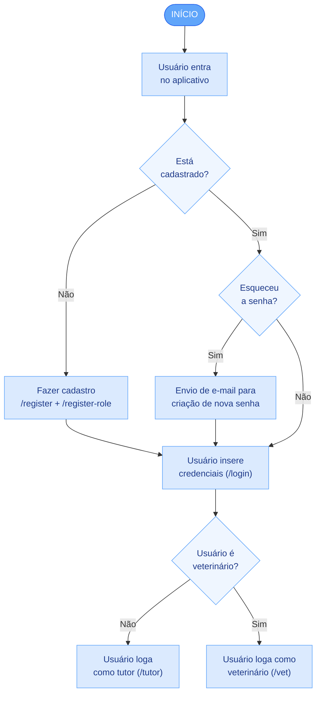
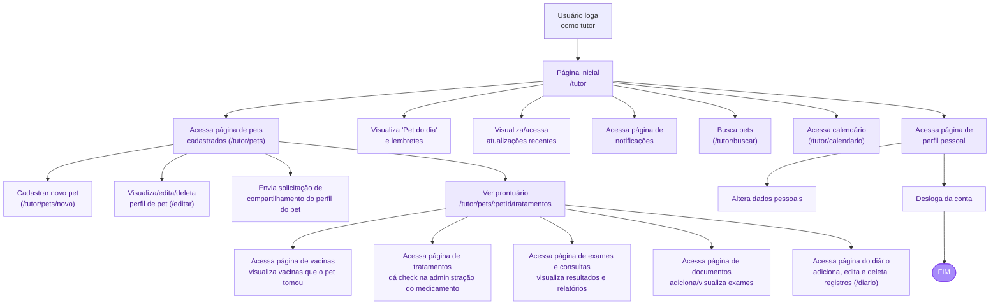
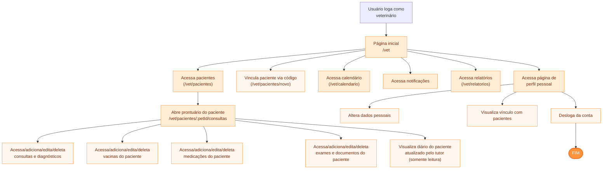
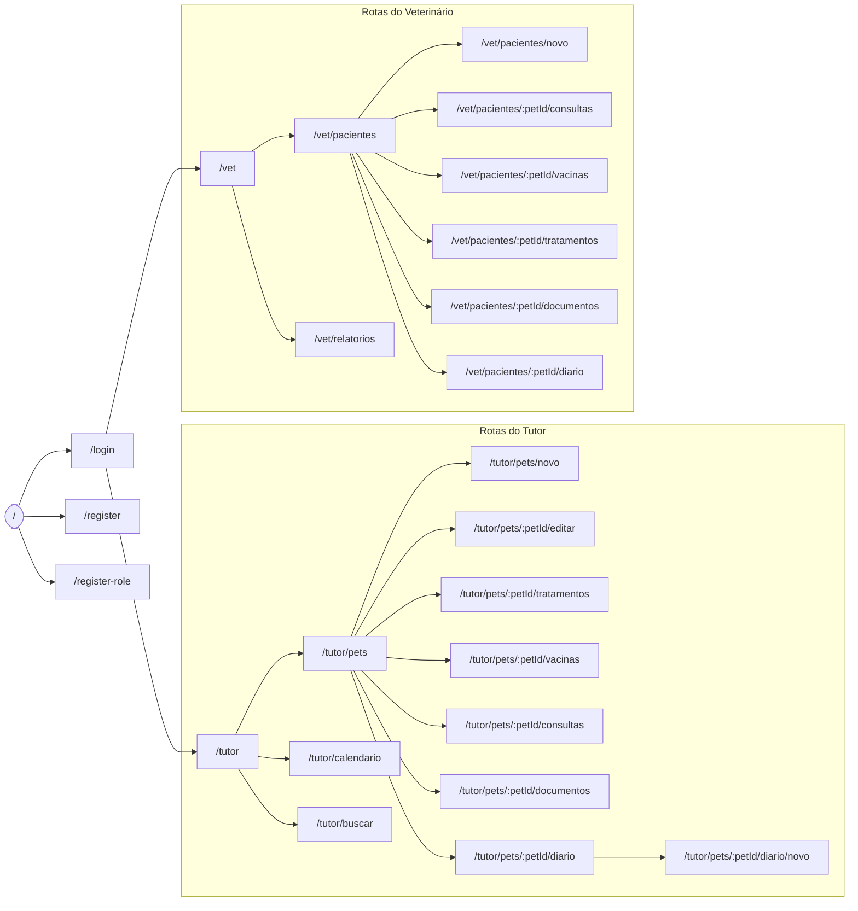

# 6. Projeto do Frontend Web — Diagrama de Fluxo e Wireframes

> **Projeto:** PetLife — Prontuário Eletrônico Distribuído para Pets
> **Etapa / Rubrica:** Tarefa `T1.8` — **H37a** (Wireframes do Frontend Web e Fluxograma de Navegação)
> **Perfis do sistema:** **Tutor** e **Veterinário**

Este documento apresenta o **Diagrama de Fluxo (Fluxograma de Navegação)** e os **Wireframes** das telas do frontend web do PetLife. Os diagramas estão em [Mermaid](https://mermaid.js.org/) (renderizados automaticamente pelo GitHub) e **refletem fielmente as rotas e telas implementadas** em `src/frontend/petlife-web/src/` — em especial o arquivo de rotas `src/routes/AppRouter.tsx` e os menus de navegação `Sidebar.tsx` (Tutor) e `VetSidebar.tsx` (Veterinário).

---

## 6.1. Diagrama de Fluxo (Fluxograma de Navegação)

O fluxograma é dividido em três blocos, seguindo a jornada real do sistema:

1. **Login e Cadastro** — ponto de entrada comum a todos os usuários.
2. **Fluxo do Tutor** — jornada do dono do pet.
3. **Fluxo do Veterinário** — jornada do profissional.

### 6.1.1. Bloco 1 — Login e Cadastro

Fluxo de entrada no aplicativo até a bifurcação por perfil. Rotas reais: `/` (Home), `/login`, `/register`, `/register-role`.



### 6.1.2. Bloco 2 — Fluxo do Tutor

Jornada do tutor a partir do login. Todas as rotas abaixo existem em `AppRouter.tsx`; os itens do menu lateral vêm de `Sidebar.tsx`. Cobre as histórias **TUT-01 a TUT-10**.



> **Permissões do Tutor (conforme código):** no **Diário** o botão "+ Novo registro" só aparece para o tutor (`{!isVet && ...}`); vacinas, tratamentos, consultas e documentos são exibidos com a flag `isVet` que controla a edição item a item.

### 6.1.3. Bloco 3 — Fluxo do Veterinário

Jornada do veterinário a partir do login. Rotas de `AppRouter.tsx` e menu de `VetSidebar.tsx`. Cobre as histórias **VET-01 a VET-10**.



> **Permissões do Veterinário (conforme código):** o diário é exibido em **somente leitura** (sem botão de novo registro); vacinas, tratamentos, consultas e documentos são editáveis (`isVet = true`).

### 6.1.4. Mapa Global de Rotas (fiel ao `AppRouter.tsx`)



> ⚠️ **Nota de fidelidade:** os menus laterais (`Sidebar.tsx` / `VetSidebar.tsx`) incluem os itens **Notificações** (`/tutor/notificacoes`, `/vet/notificacoes`), **Perfil** (`/tutor/perfil`, `/vet/perfil`) e **Calendário do Vet** (`/vet/calendario`). Esses caminhos **ainda não possuem `<Route>` dedicada** no `AppRouter.tsx` e caem nas rotas coringa `/tutor/*` e `/vet/*` (que renderizam a página inicial). Eles aparecem no fluxograma porque estão no menu, mas estão sinalizados aqui como pendentes de implementação de rota.

---

## 6.2. Wireframes do Frontend Web

Wireframes (lo-fi) das telas-chave em resolução **desktop**, baseados nas páginas reais em `src/pages/`. O layout é responsivo (RNF-02): em telas menores a *sidebar* colapsa e os *grids* reduzem para uma coluna.

### 6.2.1. Tela de Login (`/login` — `LoginPage.tsx`)

```text
+--------------------------------------------------------------+
|                      🐾  PetLife                             |
|            Prontuário de saúde do seu pet                    |
|          +----------------------------------------+          |
|          |  E-mail                                 |         |
|          |  [____________________________________] |         |
|          |  Senha                                  |         |
|          |  [____________________________________] |         |
|          |        [      ENTRAR      ]             |         |
|          |  --------  ou  ----------               |         |
|          |  Não tem conta?  Cadastre-se >          |         |
|          +----------------------------------------+          |
+--------------------------------------------------------------+
```
**Elementos:** campos e-mail/senha, botão Entrar (`POST /api/users/login`), link para `/register`. Após o cadastro, `/register-role` define o perfil. Relaciona-se a **TUT-01 / VET-01**.

### 6.2.2. Dashboard do Tutor (`/tutor` — `TutorHomePage.tsx`)

```text
+-------------------+------------------------------------------------------+
|  🐾 PetLife       |  Olá, Helena 👋            [🔔 3]     [ Sair ]       |
|                   +------------------------------------------------------+
|  [▸] Início       |  +------------------------+  +--------------------+  |
|  [ ] Meus Pets    |  |  PET EM DESTAQUE       |  |  ALERTAS           |  |
|  [ ] Calendário   |  |  +------+ Bob          |  |  🔴 Vacina vence   |  |
|  [ ] Notificações |  |  | foto | Cão · 11a    |  |  🟡 Dose Dipirona  |  |
|  [ ] Buscar       |  |  +------+ 8,2 kg       |  |  🟢 Exame anexado  |  |
|  [ ] Perfil       |  |  [ Ver prontuário ]    |  +--------------------+  |
|  +-------------+  |  +------------------------+                          |
|  | 👤 Helena   |  |  ATUALIZAÇÕES CLÍNICAS RECENTES                      |
|  | Tutor       |  |  • Vacina V10 registrada  — 01/11                   |
|  | [ Sair ]    |  |  • Laudo hemograma anexado — 28/10                  |
|  +-------------+  |                                                      |
+-------------------+------------------------------------------------------+
```
**Elementos:** saudação dinâmica, badge de notificações (link `/tutor/notificacoes`), `FeaturedPetCard` (foto, espécie, idade, peso; botão leva a `/tutor/pets/:id/editar`), listas de alertas e atualizações. Menu lateral: Início, Meus Pets, Calendário, Notificações, Buscar, Perfil. Relaciona-se a **TUT-02/03/04**.

### 6.2.3. Meus Pets (`/tutor/pets` — `MyPetsPage.tsx` + `PetCard.tsx`)

```text
+-------------------+------------------------------------------------------+
|  SIDEBAR TUTOR    |  Meus Pets                      [ + Novo Pet ]       |
|                   +------------------------------------------------------+
|                   |  +----------------+  +----------------+              |
|                   |  | +----+  Bob     |  | +----+  Luna    |             |
|                   |  | |foto| Cão·11a  |  | |foto| Gato·3a  |             |
|                   |  | +----+ 8,2 kg   |  | +----+ 4,0 kg   |             |
|                   |  | [Ver prontuário]|  | [Ver prontuário]|            |
|                   |  | [Editar][Excluir]| | [Editar][Excluir]|           |
|                   |  | [ Compartilhar ] |  | [ Compartilhar ] |          |
|                   |  +----------------+  +----------------+              |
+-------------------+------------------------------------------------------+
```
**Elementos:** grid de `PetCard` com ações reais — **Ver prontuário** (`/tutor/pets/:id/tratamentos`), **Editar** (`/tutor/pets/:id/editar`), **Excluir** (confirm) e **Compartilhar** (`SharePetButton` → `POST /api/shares/createshare`, gera código). Botão **+ Novo Pet** → `/tutor/pets/novo`. Relaciona-se a **TUT-02 / TUT-09** / **RF-02, RF-09**.

### 6.2.4. Cadastro/Edição de Pet (`/tutor/pets/novo` e `/:petId/editar` — `PetFormPage.tsx`)

```text
+-------------------+------------------------------------------------------+
|  SIDEBAR TUTOR    |  < Voltar     Cadastrar / Editar Pet                 |
|                   +------------------------------------------------------+
|                   |  Foto     [ 📷 upload ]                              |
|                   |  Nome     [________________]                         |
|                   |  Espécie  [____v]   Raça  [________]                 |
|                   |  Idade    [___]     Peso  [____] kg                  |
|                   |  Microchip[__________________________]              |
|                   |                       [ Cancelar ]  [ Salvar ]      |
+-------------------+------------------------------------------------------+
```
**Elementos:** formulário com nome, foto, espécie, raça, idade, peso e microchip. Relaciona-se a **TUT-02** / **RF-02**.

### 6.2.5. Prontuário do Pet — Abas (`/tutor/pets/:petId/tratamentos` e demais)

```text
+-------------------+------------------------------------------------------+
|  SIDEBAR TUTOR    |  < Voltar   Bob  (Cão · 11a · 8,2kg)                 |
|                   +------------------------------------------------------+
|                   | [Tratamentos][Vacinas][Consultas][Documentos][Diário]|
|                   +------------------------------------------------------+
|                   |  TRATAMENTOS                     [ + Novo tratamento]|
|                   |  Dipirona 25mg · 2x/dia · 7 dias                     |
|                   |  Hoje:  08h [✔ dada]   20h [ marcar como dada ]      |
|                   +------------------------------------------------------+
```
**Elementos:** navegação por abas (Tratamentos, Vacinas, Consultas, Documentos, Diário); para o tutor, foco em **visualizar e dar check** na administração do medicamento. Relaciona-se a **TUT-03 a TUT-06** / **RF-03 a RF-06**.

### 6.2.6. Diário do Pet (`/tutor/pets/:petId/diario` — `DiaryPage.tsx`)

```text
+-------------------+------------------------------------------------------+
|  SIDEBAR TUTOR    |  Diário de Bob               [ + Novo registro ]     |
|                   +------------------------------------------------------+
|                   |  03/11  Vômito após troca de ração        [edit][x] |
|                   |  02/11  Coçando a orelha esquerda          [edit][x]|
|                   |  30/10  Mais disposto após caminhada       [edit][x]|
+-------------------+------------------------------------------------------+
```
**Elementos:** lista cronológica; botão **+ Novo registro** leva a `/tutor/pets/:petId/diario/novo` (`DiaryFormPage.tsx`) — **visível apenas para o tutor**. Relaciona-se a **TUT-07** / **RF-08**.

### 6.2.7. Dashboard do Veterinário (`/vet` — `VetHomePage.tsx`)

```text
+-------------------+------------------------------------------------------+
|  🐾 PetLife VET   |  Dr(a). Mariana · CRMV 12345     [🔔]   [ Sair ]     |
|                   +------------------------------------------------------+
|  [▸] Início       |  +---------------------------+                       |
|  [ ] Pacientes    |  | PACIENTES ATIVOS:   18    |                       |
|  [ ] Novo Pac.    |  +---------------------------+                       |
|  [ ] Calendário   |  Buscar: [__________________] 🔍                     |
|  [ ] Notificações |  (nome, tutor, espécie ou raça)                      |
|  [ ] Perfil       |  +-------------+  +-------------+  +-------------+   |
|  [ ] Relatórios   |  | 🐶 Bob      |  | 🐱 Luna     |  | 🐶 Zeus     |   |
|                   |  | Tutor:Helena|  | Tutor: Ana  |  | Tutor: João |   |
|                   |  | [Prontuário]|  | [Prontuário]|  | [Prontuário]|   |
+-------------------+------------------------------------------------------+
```
**Elementos:** cabeçalho com CRMV, card de pacientes ativos, busca preditiva, grid de cards. Menu lateral: Início, Pacientes, Novo Paciente, Calendário, Notificações, Perfil, Relatórios. Relaciona-se a **VET-09/10**.

### 6.2.8. Gestão de Pacientes (`/vet/pacientes` — `VetPatientsPage.tsx`)

```text
+-------------------+------------------------------------------------------+
|  SIDEBAR VET      |  Gestão de Pacientes          [ + Novo Paciente ]    |
|                   +------------------------------------------------------+
|                   |  Buscar: [______________] 🔍                        |
|                   |  +------------------------------------------------+  |
|                   |  |Foto| Pet  |Espécie|Raça  |Tutor |Últ.consulta  |  |
|                   |  |[  ]| Bob  | Cão   |SRD   |Helena|01/11/2026    |  |
|                   |  |    |      |       |      |      |[Abrir prontu.]| |
|                   |  +------------------------------------------------+  |
+-------------------+------------------------------------------------------+

   MODAL "Novo Paciente" (/vet/pacientes/novo)
   +---------------------------------------------+
   |  Vincular paciente                    [ x ] |
   |  Código de compartilhamento (8 dígitos):    |
   |  [ A 7 X 9 - K 2 P Q ]                       |
   |             [ Cancelar ]  [ Vincular ]      |
   +---------------------------------------------+
```
**Elementos:** tabela (foto, espécie, raça, tutor, última consulta), busca, **Abrir prontuário** (`/vet/pacientes/:id/consultas`), modal de vínculo via código (`redeemPatientShareCode` → `POST /api/shares/redeemsharecode`). Relaciona-se a **VET-09** / **RF-09**.

### 6.2.9. Prontuário do Paciente — Veterinário (`/vet/pacientes/:petId/consultas` e abas)

```text
+-------------------+------------------------------------------------------+
|  SIDEBAR VET      |  Prontuário · Bob (Cão · 11a) · Tutor: Helena        |
|                   +------------------------------------------------------+
|                   | [Consultas][Vacinas][Tratamentos][Documentos][Diário]|
|                   +------------------------------------------------------+
|                   |  CONSULTAS                        [ + Nova consulta ]|
|                   |  01/11  Consulta de rotina — sem alterações  [ed][x]|
|                   |  15/06  Otite tratada com antibiótico        [ed][x]|
+-------------------+------------------------------------------------------+
```
**Elementos:** abas clínicas; consultas, vacinas, tratamentos e documentos **editáveis** (`isVet = true`, botões "+ Nova/Novo" e editar/excluir por item); aba **Diário em somente leitura** (sem "+ Novo registro"). Relaciona-se a **VET-02 a VET-08**.

### 6.2.10. Relatórios do Veterinário (`/vet/relatorios` — `ReportsPage.tsx`)

```text
+-------------------+------------------------------------------------------+
|  SIDEBAR VET      |  Relatórios                                         |
|                   +------------------------------------------------------+
|                   |  Paciente [____v]  Período [__/__ a __/__]           |
|                   |  Tipo [ Vacinas | Tratamentos | Consultas ]          |
|                   |              [ Gerar relatório ]  [ Baixar PDF ]     |
+-------------------+------------------------------------------------------+
```
**Elementos:** geração e download de relatórios consolidados (`reportService.ts` → `downloadReportPdf`). Relaciona-se a **RF-11**.

### 6.2.11. Layout Base e Sidebar (`Sidebar.tsx` / `VetSidebar.tsx`)

```text
+----------------------+   TUTOR: identidade visual laranja/rosa
|  🐾 PetLife          |   VET:   identidade visual ciano/azul
|----------------------|
|  [▸] Início          |   ← item ativo destacado
|  [ ] (demais itens)  |
|----------------------|
|  +----------------+  |
|  | 👤  Nome        |  |   ← rodapé: avatar, nome, perfil/CRMV
|  |    Perfil/CRMV  |  |      (link para /tutor/perfil ou /vet/perfil)
|  |  [   Sair   ]   |  |   ← logout: limpa sessão e vai para /login
|  +----------------+  |
+----------------------+
```
**Elementos:** `aside` persistente com itens de menu reais, indicação de rota ativa, rodapé com dados do usuário e botão **Sair** (`logout()` + `navigate("/login")`).

---

## 6.3. Rastreabilidade (Telas × Rotas reais × Requisitos × Histórias)

| Tela / Fluxo                     | Rota real (`AppRouter.tsx`)             | RF                | História(s)        |
| :------------------------------- | :-------------------------------------- | :---------------- | :----------------- |
| Home pública                     | `/`                                     | —                 | —                  |
| Login                            | `/login`                                | RF-01             | TUT-01, VET-01     |
| Cadastro / Escolha de perfil     | `/register`, `/register-role`           | RF-01             | TUT-01, VET-01     |
| Dashboard do Tutor               | `/tutor`                                | RF-02 a RF-04     | TUT-02/03/04       |
| Meus Pets                        | `/tutor/pets`                           | RF-02             | TUT-02             |
| Cadastro/Edição de Pet           | `/tutor/pets/novo`, `/:petId/editar`    | RF-02             | TUT-02             |
| Prontuário Tutor — Tratamentos   | `/tutor/pets/:petId/tratamentos`        | RF-04             | TUT-04             |
| Prontuário Tutor — Vacinas       | `/tutor/pets/:petId/vacinas`            | RF-03             | TUT-03             |
| Prontuário Tutor — Consultas     | `/tutor/pets/:petId/consultas`          | RF-06             | TUT-06             |
| Prontuário Tutor — Documentos    | `/tutor/pets/:petId/documentos`         | RF-05             | TUT-05             |
| Diário do Pet                    | `/tutor/pets/:petId/diario` (+ `/novo`) | RF-08             | TUT-07             |
| Calendário do Tutor              | `/tutor/calendario`                     | RF-07             | TUT-08, TUT-10     |
| Buscar                           | `/tutor/buscar`                         | RF-02             | TUT-02             |
| Dashboard do Veterinário         | `/vet`                                  | RF-02, RF-06      | VET-09/10          |
| Gestão de Pacientes              | `/vet/pacientes`                        | RF-09             | VET-09             |
| Vincular Paciente                | `/vet/pacientes/novo`                   | RF-09             | VET-09             |
| Prontuário Vet — Consultas       | `/vet/pacientes/:petId/consultas`       | RF-06             | VET-06             |
| Prontuário Vet — Vacinas         | `/vet/pacientes/:petId/vacinas`         | RF-03             | VET-03             |
| Prontuário Vet — Tratamentos     | `/vet/pacientes/:petId/tratamentos`     | RF-04             | VET-04             |
| Prontuário Vet — Documentos      | `/vet/pacientes/:petId/documentos`      | RF-05             | VET-05             |
| Prontuário Vet — Diário (leitura)| `/vet/pacientes/:petId/diario`          | RF-08             | VET-07             |
| Relatórios                       | `/vet/relatorios`                       | RF-11             | —                  |

> **Observação de permissão (RNF-03), conforme o código:** no **Diário**, somente o Tutor cria registros (botão "+ Novo registro" condicionado a `!isVet`); o Veterinário visualiza. Nas abas de Vacinas, Tratamentos, Consultas e Documentos, a flag `isVet` controla a edição por item. Os itens de menu **Notificações**, **Perfil** e **Calendário (Vet)** estão presentes nas sidebars, porém ainda sem `<Route>` dedicada no `AppRouter.tsx` (pendência de implementação).
