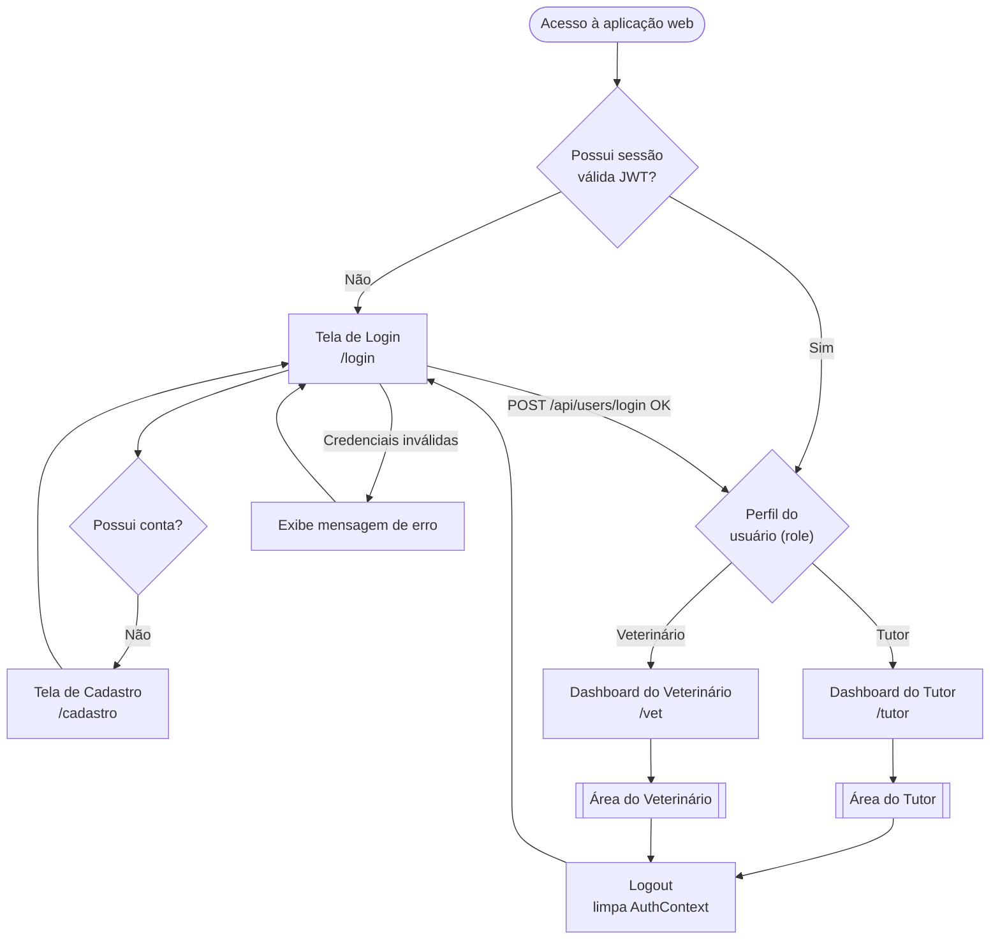
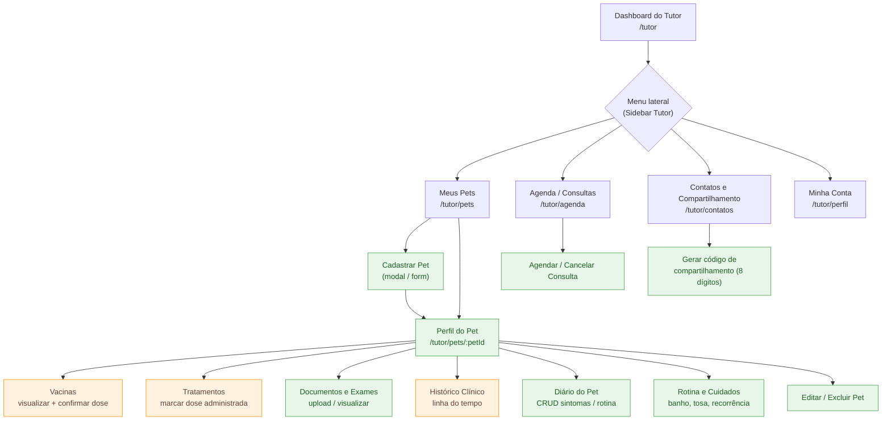
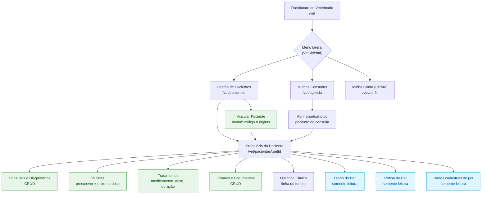
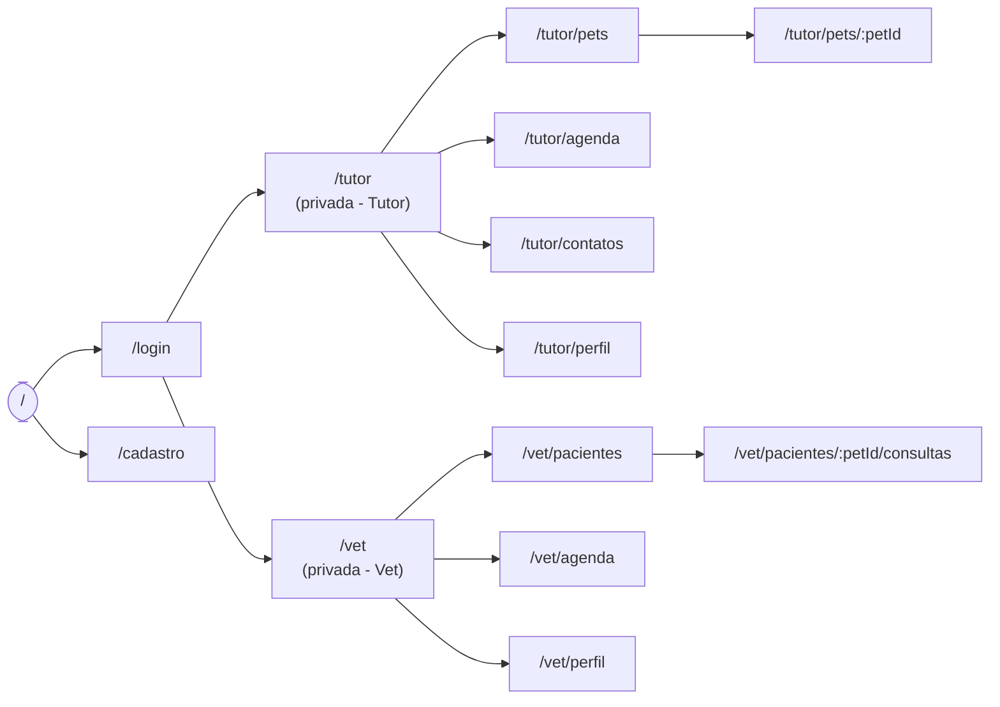

# 6. Projeto do Frontend Web — Diagrama de Fluxo e Wireframes

> **Projeto:** PetLife — Prontuário Eletrônico Distribuído para Pets
> **Etapa / Rubrica:** Tarefa `T1.8` — **H37a** (Wireframes do Frontend Web e Fluxograma de Navegação)
> **Perfis do sistema:** **Tutor** e **Veterinário**

Este documento apresenta o **Diagrama de Fluxo (Fluxograma de Navegação)** e os **Wireframes** das telas do frontend web do PetLife. Os diagramas estão em [Mermaid](https://mermaid.js.org/), renderizados automaticamente pelo GitHub, e os wireframes usam diagramação textual (ASCII) versionável, mantendo coerência com os requisitos funcionais (RF-01 a RF-12) e as histórias de usuário (TUT-01 a TUT-10 e VET-01 a VET-10) descritos em [`docs/contexto.md`](contexto.md).

---

## 6.1. Diagrama de Fluxo (Fluxograma de Navegação)

### 6.1.1. Fluxo Macro — Autenticação e Roteamento por Perfil

O fluxograma abaixo descreve a jornada de entrada no sistema: a partir da tela de login, o JWT emitido pelo backend carrega a *claim* `role`, que direciona o usuário para o dashboard correspondente (`/tutor` ou `/vet`). As rotas privadas são protegidas por *route guards* que validam o token antes de renderizar cada página.



### 6.1.2. Fluxo de Navegação — Área do Tutor

Cobre as histórias **TUT-01 a TUT-10**. O tutor tem acesso de escrita ao perfil do pet, diário, rotina, documentos, agenda e compartilhamento, e acesso de **leitura/confirmação** sobre vacinas e tratamentos prescritos pelo veterinário.



> 🟧 **Laranja (leitura/confirmação):** o tutor visualiza e confirma, mas **não edita** a prescrição.
> 🟩 **Verde (escrita):** o tutor cria, edita e exclui livremente.

### 6.1.3. Fluxo de Navegação — Área do Veterinário

Cobre as histórias **VET-01 a VET-10**. O veterinário acessa pacientes compartilhados, prescreve vacinas e tratamentos, registra consultas/diagnósticos e **visualiza** (sem editar) o diário e a rotina criados pelo tutor.



> 🟦 **Azul (somente leitura):** diário, rotina e dados cadastrais pertencem ao tutor.
> 🟩 **Verde (escrita):** prescrições, consultas, exames e vínculo de pacientes.

### 6.1.4. Mapa Global de Rotas



---

## 6.2. Wireframes do Frontend Web

Os wireframes a seguir representam a estrutura (lo-fi) das telas-chave em resolução **desktop**. O layout é responsivo (RNF-02): em telas menores a *sidebar* colapsa em menu hambúrguer e os *grids* reduzem para uma coluna.

### 6.2.1. Tela de Login (`/login`)

```text
+--------------------------------------------------------------+
|                                                              |
|                      🐾  PetLife                             |
|            Prontuário de saúde do seu pet                    |
|                                                              |
|          +----------------------------------------+          |
|          |  E-mail                                 |         |
|          |  [____________________________________] |         |
|          |                                         |         |
|          |  Senha                                  |         |
|          |  [____________________________________] |         |
|          |                                         |         |
|          |  [ ] Lembrar-me      Esqueci a senha >  |         |
|          |                                         |         |
|          |        [      ENTRAR      ]             |         |
|          |                                         |         |
|          |  --------  ou  ----------               |         |
|          |  Não tem conta?  Cadastre-se >          |         |
|          +----------------------------------------+          |
|                                                              |
+--------------------------------------------------------------+
```
**Elementos:** campos e-mail/senha, botão Entrar (POST `/api/users/login`), link para cadastro, mensagens de erro inline (credenciais inválidas). Relaciona-se a **TUT-01 / VET-01**.

### 6.2.2. Dashboard do Tutor (`/tutor`)

```text
+-------------------+------------------------------------------------------+
|  🐾 PetLife       |  Olá, Helena 👋            [🔔 3]     [ Sair ]       |
|                   +------------------------------------------------------+
|  [▸] Início       |                                                      |
|  [ ] Meus Pets    |  +------------------------+  +--------------------+  |
|  [ ] Agenda       |  |  PET EM DESTAQUE       |  |  ALERTAS           |  |
|  [ ] Contatos     |  |  +------+ Bob          |  |  🔴 Vacina vence   |  |
|  [ ] Minha Conta  |  |  | foto | Cão · 11a    |  |     em 2 dias      |  |
|                   |  |  +------+ 8,2 kg       |  |  🟡 Dose Dipirona  |  |
|                   |  |  Próx. vacina: 05/11   |  |     às 20h         |  |
|                   |  |  Medicação: Dipirona   |  |  🟢 Exame anexado  |  |
|  +-------------+  |  |  [ Ver prontuário ]    |  +--------------------+  |
|  | 👤 Helena   |  |  +------------------------+                          |
|  | Tutor       |  |                                                      |
|  | [ Logout ]  |  |  ATUALIZAÇÕES CLÍNICAS RECENTES                      |
|  +-------------+  |  • Dr. Mariana registrou vacina V10  — 01/11        |
|                   |  • Laudo hemograma adicionado         — 28/10       |
+-------------------+------------------------------------------------------+
```
**Elementos:** saudação dinâmica, badge de notificações, `FeaturedPetCard`, `AlertsList` (códigos de urgência), `VetUpdatesList`, logout. Relaciona-se a **TUT-02/03/04**.

### 6.2.3. Meus Pets — Listagem e Cadastro (`/tutor/pets`)

```text
+-------------------+------------------------------------------------------+
|  SIDEBAR TUTOR    |  Meus Pets                      [ + Novo Pet ]       |
|                   +------------------------------------------------------+
|                   |  Buscar: [________________]  🔍                      |
|                   |                                                      |
|                   |  +---------------+  +---------------+  +----------+  |
|                   |  | +----+        |  | +----+        |  | +----+   |  |
|                   |  | |foto| Bob    |  | |foto| Luna   |  | |foto|   |  |
|                   |  | +----+ Cão    |  | +----+ Gato   |  | +----+   |  |
|                   |  | 11 anos       |  | 3 anos        |  |  ...     |  |
|                   |  | [ Abrir ]     |  | [ Abrir ]     |  |          |  |
|                   |  +---------------+  +---------------+  +----------+  |
+-------------------+------------------------------------------------------+

   MODAL "Novo Pet"
   +---------------------------------------------+
   |  Cadastrar Pet                        [ x ] |
   |  Nome   [__________]  Foto  [ 📷 upload ]   |
   |  Espécie[____v]  Raça [__________]          |
   |  Idade  [___]    Peso [____] kg             |
   |  Microchip [____________________]           |
   |                 [ Cancelar ]  [ Salvar ]    |
   +---------------------------------------------+
```
**Elementos:** grid de cards, busca, modal de CRUD (nome, foto, peso, microchip, idade, espécie, raça). Relaciona-se a **TUT-02** / **RF-02**.

### 6.2.4. Perfil do Pet — Abas Clínicas (`/tutor/pets/:petId`)

```text
+-------------------+------------------------------------------------------+
|  SIDEBAR TUTOR    |  < Voltar   Bob  (Cão · 11a · 8,2kg)   [Editar][🗑]  |
|                   +------------------------------------------------------+
|                   | [Visão geral][Vacinas][Tratamentos][Documentos]      |
|                   | [Histórico][Diário][Rotina]                          |
|                   +------------------------------------------------------+
|                   |  VACINAS (leitura + confirmar)                       |
|                   |  +------------------------------------------------+  |
|                   |  | Vacina   | Aplicada | Próx. dose | Status      |  |
|                   |  | V10      | 01/11/26 | 01/11/27   | [ Confirmar]|  |
|                   |  | Antirráb.| 15/06/26 | 15/06/27   | ✔ Confirmada|  |
|                   |  +------------------------------------------------+  |
|                   |  TRATAMENTOS                                        |
|                   |  Dipirona 25mg · 2x/dia · 7 dias                    |
|                   |  Hoje:  08h [✔ dada]   20h [ marcar como dada ]     |
+-------------------+------------------------------------------------------+
```
**Elementos:** navegação por abas; vacinas/tratamentos em **modo leitura/confirmação** (prescrição é do vet); upload de documentos, linha do tempo, diário e rotina editáveis. Relaciona-se a **TUT-03 a TUT-08**.

### 6.2.5. Diário do Pet (`/tutor/pets/:petId` → aba Diário)

```text
+-------------------+------------------------------------------------------+
|  SIDEBAR TUTOR    |  Diário de Bob               [ + Novo registro ]     |
|                   +------------------------------------------------------+
|                   |  03/11  Vômito após troca de ração        [edit][x] |
|                   |  02/11  Coçando a orelha esquerda          [edit][x]|
|                   |  30/10  Mais disposto após caminhada       [edit][x]|
|                   |                                                      |
|                   |  MODAL Novo registro:                               |
|                   |  Data [__/__/__]  Tipo [sintoma v]                   |
|                   |  Descrição [______________________________]         |
|                   |                      [ Cancelar ] [ Salvar ]        |
+-------------------+------------------------------------------------------+
```
**Elementos:** lista cronológica de ocorrências; CRUD de sintomas/comportamentos. Relaciona-se a **TUT-07** / **RF-08**.

### 6.2.6. Contatos e Compartilhamento (`/tutor/contatos`)

```text
+-------------------+------------------------------------------------------+
|  SIDEBAR TUTOR    |  Contatos e Compartilhamento                        |
|                   +------------------------------------------------------+
|                   |  Veterinários com acesso ao perfil de Bob:          |
|                   |  • Dra. Mariana Costa (CRMV 12345)  [ Revogar ]     |
|                   |                                                      |
|                   |  Compartilhar acesso                                |
|                   |  Gere um código e informe ao veterinário:           |
|                   |            +-------------------------+                |
|                   |            |      A7X9-K2PQ           |               |
|                   |            +-------------------------+                |
|                   |      [ Gerar novo código ]  [ Copiar ]              |
+-------------------+------------------------------------------------------+
```
**Elementos:** lista de acessos concedidos com revogação; geração do código de 8 caracteres. Relaciona-se a **TUT-09** / **RF-09**.

### 6.2.7. Dashboard do Veterinário (`/vet`)

```text
+-------------------+------------------------------------------------------+
|  🐾 PetLife VET   |  Dra. Mariana Costa · CRMV 12345   [🔔]  [ Sair ]    |
|                   +------------------------------------------------------+
|  [▸] Início       |  +---------------------------+                       |
|  [ ] Pacientes    |  | PACIENTES ATIVOS:   18    |                       |
|  [ ] Consultas    |  +---------------------------+                       |
|  [ ] Minha Conta  |                                                      |
|                   |  Buscar paciente: [__________________] 🔍           |
|                   |  (nome, tutor, espécie ou raça)                     |
|                   |                                                      |
|                   |  +-------------+  +-------------+  +-------------+   |
|                   |  | 🐶 Bob      |  | 🐱 Luna     |  | 🐶 Zeus     |   |
|                   |  | Tutor:Helena|  | Tutor: Ana  |  | Tutor: João |   |
|                   |  | [Prontuário]|  | [Prontuário]|  | [Prontuário]|   |
|                   |  +-------------+  +-------------+  +-------------+   |
+-------------------+------------------------------------------------------+
```
**Elementos:** cabeçalho com CRMV, card métrico de pacientes ativos, busca preditiva, grid de `VetPatientCard`. Relaciona-se a **VET-09/10**.

### 6.2.8. Gestão de Pacientes (`/vet/pacientes`)

```text
+-------------------+------------------------------------------------------+
|  SIDEBAR VET      |  Gestão de Pacientes          [ + Novo Paciente ]    |
|                   +------------------------------------------------------+
|                   |  Buscar: [______________] 🔍                        |
|                   |  +------------------------------------------------+  |
|                   |  |Foto| Pet  |Espécie|Raça   |Tutor  |Últ.consulta|  |
|                   |  |[  ]| Bob  | Cão   |SRD    |Helena |01/11/2026  |  |
|                   |  |[  ]| Luna | Gato  |Siamês |Ana    |28/10/2026  |  |
|                   |  |    |      |       |       |       |[Abrir pront]| |
|                   |  +------------------------------------------------+  |
+-------------------+------------------------------------------------------+

   MODAL "Novo Paciente"
   +---------------------------------------------+
   |  Vincular paciente                    [ x ] |
   |  Código de compartilhamento (8 dígitos):    |
   |  [ A 7 X 9 - K 2 P Q ]                       |
   |             [ Cancelar ]  [ Vincular ]      |
   |  ✔ Paciente vinculado com sucesso           |
   +---------------------------------------------+
```
**Elementos:** tabela com foto/espécie/raça/tutor/última consulta, busca textual, botão Abrir Prontuário, modal de vínculo via código (POST `/api/shares/redeemsharecode`). Relaciona-se a **VET-09** / **RF-09**.

### 6.2.9. Prontuário do Paciente — Veterinário (`/vet/pacientes/:petId`)

```text
+-------------------+------------------------------------------------------+
|  SIDEBAR VET      |  Prontuário · Bob (Cão · 11a · 8,2kg) · Tutor:Helena |
|                   +------------------------------------------------------+
|                   | [Consultas][Vacinas][Tratamentos][Exames]            |
|                   | [Histórico][Diário 👁][Rotina 👁]                     |
|                   +------------------------------------------------------+
|                   |  NOVA CONSULTA / DIAGNÓSTICO       [ + Registrar ]   |
|                   |  +------------------------------------------------+  |
|                   |  | 01/11  Consulta de rotina — sem alterações     |  |
|                   |  | 15/06  Otite tratada com antibiótico           |  |
|                   |  +------------------------------------------------+  |
|                   |                                                      |
|                   |  PRESCREVER TRATAMENTO                               |
|                   |  Medicamento[________] Dose[____] Freq[__] Dur[__]  |
|                   |                        [ Encerrar ] [ Salvar ]      |
+-------------------+------------------------------------------------------+
```
**Elementos:** abas clínicas; consultas/vacinas/tratamentos/exames **editáveis**; diário e rotina marcados com 👁 (**somente leitura**). Relaciona-se a **VET-02 a VET-08**.

### 6.2.10. Estrutura de Layout Base e Sidebar

```text
+----------------------+   TUTOR: gradiente laranja/rosa
|  🐾 PetLife          |   VET:   gradiente ciano/azul
|----------------------|
|  [▸] Início          |   ← item ativo destacado
|  [ ] (módulos)       |
|      ...             |
|----------------------|
|  +----------------+  |
|  | 👤  Nome        |  |   ← rodapé: avatar, nome,
|  |    Perfil/CRMV  |  |      perfil/CRMV
|  |  [  Logout  ]   |  |   ← logout universal c/ confirmação
|  +----------------+  |
+----------------------+
```
**Elementos:** `aside` persistente, estilização diferenciada por perfil, indicação de rota ativa, rodapé com dados do usuário e logout. Responsivo: colapsa em menu hambúrguer no mobile (RNF-02).

---

## 6.3. Rastreabilidade (Telas × Requisitos × Histórias)

| Tela / Fluxo                     | Rota                         | Requisito(s)      | História(s)              |
| :------------------------------- | :--------------------------- | :---------------- | :----------------------- |
| Login / Cadastro                 | `/login`, `/cadastro`        | RF-01             | TUT-01, VET-01           |
| Dashboard do Tutor               | `/tutor`                     | RF-02, RF-03, RF-04 | TUT-02, TUT-03, TUT-04 |
| Meus Pets (CRUD)                 | `/tutor/pets`                | RF-02             | TUT-02                   |
| Perfil do Pet (abas clínicas)    | `/tutor/pets/:petId`         | RF-03 a RF-06     | TUT-03 a TUT-06          |
| Diário do Pet                    | `/tutor/pets/:petId` (aba)   | RF-08             | TUT-07                   |
| Rotina e Cuidados                | `/tutor/pets/:petId` (aba)   | RF-07             | TUT-08                   |
| Agenda / Consultas (Tutor)       | `/tutor/agenda`              | RF-07             | TUT-10                   |
| Contatos e Compartilhamento      | `/tutor/contatos`            | RF-09             | TUT-09                   |
| Dashboard do Veterinário         | `/vet`                       | RF-02, RF-06      | VET-09, VET-10           |
| Gestão de Pacientes              | `/vet/pacientes`             | RF-09             | VET-09                   |
| Prontuário do Paciente           | `/vet/pacientes/:petId`      | RF-03 a RF-06     | VET-02 a VET-08          |
| Minhas Consultas (Vet)           | `/vet/agenda`                | RF-07             | VET-10                   |

> **Regra de permissão transversal (RNF-03):** vacinas e tratamentos são **criados/editados exclusivamente pelo Veterinário**; o Tutor apenas visualiza e confirma administração. Diário e rotina são **do Tutor**; o Veterinário apenas visualiza.
